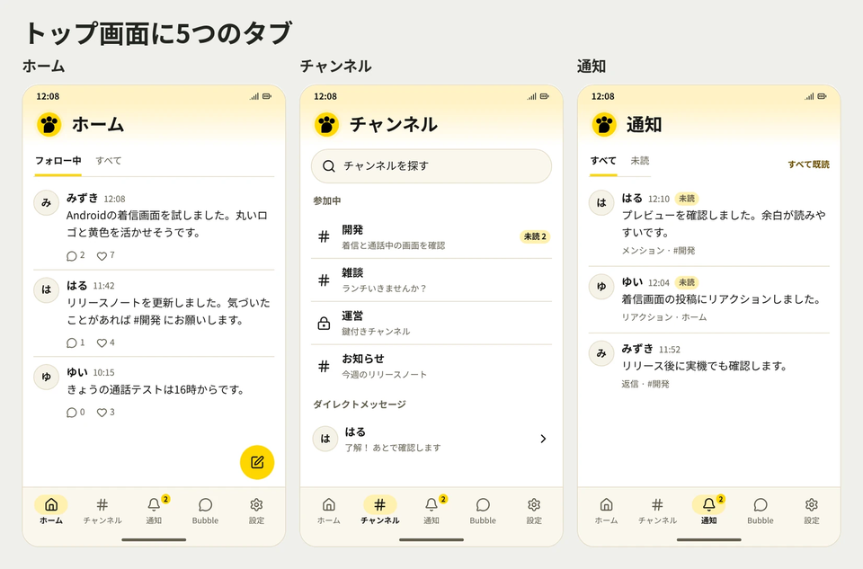
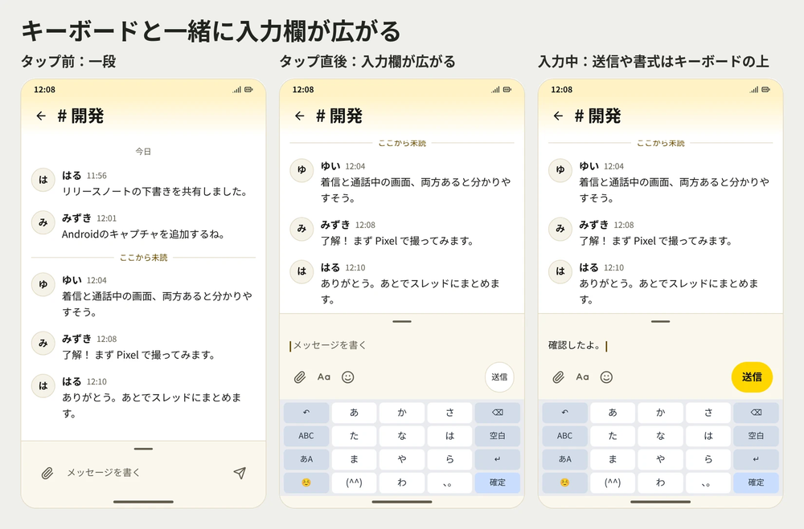

# Zoo2 Android の UI デザインサンプル

作り直しブランチの描画は [新しい Compose 実キャプチャ](android-rebuild-samples.md) を参照する。

**デザインモック**は画面を作るときの参照画像。**Compose 実キャプチャ**は API 35 の Robolectric でテストデータを使ってアプリの部品を描画したもの。複数のモックで同じ画面が登場する場合、チャンネル名・入力欄・アイコン操作は下の個別サンプルを優先する。

## トップと子画面



| 画面 | Compose 実キャプチャ | 見る箇所 |
| --- | --- | --- |
| ホーム | [タイムライン](images/android-design/home.png) | 枠を減らした投稿、無彩色の本文面、投稿アイコン |
| チャンネル | [一覧](images/android-design/channels.png) | 検索、参加中、DM。新デザインは名前を1行で表示し、未読がある場合だけ太字にする。説明文と区切り線は省く。キャプチャは旧版。 |
| 通知 | [通知一覧](images/android-design/notifications.png) | 送信者、通知元、抜粋、未読表示 |
| Bubble・設定 | [Bubble](images/android-design/bubble.png)・[設定トップ](images/android-design/settings.png) | 5タブから直接開けるトップ |
| 投稿詳細・会話・スレッド | [会話](images/android-design/channel-editor-idle.png)・[スレッド](images/android-design/thread.png) | 子画面ではタブを隠し、入力操作は下に置く |

[Bubble・設定のモック](images/android-design/reference/bubble-settings.png) · [投稿詳細・会話・スレッドのモック](images/android-design/reference/detail.png) · [初回のチャンネル一覧とスレッドの比較](images/android-design/agreed-comparison.png)

チャンネル一覧の現在のデザインは上表の実キャプチャを参照する。トップのモックと初回比較には2行だった頃の一覧が含まれる。

## チャンネルヘッダーと入力欄



| 状態 | デザインモック | Compose 実キャプチャ |
| --- | --- | --- |
| チャンネルヘッダー | [名前と説明の比較の右側](images/android-design/reference/channel-header.png)。名前が主、説明は通常ウェイトで一行、長い場合は末尾を省略。名前から設定を開く。 | [会話ヘッダー](images/android-design/channel-editor-idle.png) |
| 待機 → 入力中 | [入力の変化](images/android-design/reference/composer-focus.png)。タップで入力欄が広がり、上端のつまみはドラッグに追従する。 | [待機](images/android-design/channel-editor-idle.png)・[入力中](images/android-design/channel-editor-focused.png) |
| 全画面入力 | [操作列と書式アイコン](images/android-design/reference/composer-fullscreen.png)。操作列は下端に置く。 | [全画面](images/android-design/channel-editor-expanded.png) |
| アイコン操作 | [投稿、送信、装飾](images/android-design/reference/icon-actions.png)。識別できる操作はアイコンで表示し、読み上げ名を付ける。 | [320dp ライト](images/android-design/primitives-320-light.png)・[320dp ダーク・文字倍率180%](images/android-design/primitives-320-large-text-dark.png)・[600dp ダーク](images/android-design/primitives-600-dark.png) |

実キャプチャは OS のキーボードを含まない。指への追従、左スワイプ返信、長押し、触覚、スレッドに入るときと戻るときの動きは、静止画に加えて操作で確認する。

## 通話と端末連携

| 画面 | デザインモック | 見る箇所 |
| --- | --- | --- |
| 着信 | [ライト・ダーク](images/android-design/reference/call-themes.webp) | 黄色い着信マーク、テーマに合わせた背景、中央の内容幅ボタン |
| ホーム投稿の写真 | [投稿画面内で選択](images/android-design/reference/post-photos.webp) | 最近の写真と OS の写真ピッカーを同じ下書きから使う |
| ログイン | [アプリからブラウザを開いてホームに戻る](images/android-design/reference/sign-in.webp) | 同じ端末で認証を完了し、アプリに復帰する |
| OS 通知 | [通知シェードの展開例](images/android-design/reference/notification-shade.webp) | 本文の抜粋、画像、通知からの操作 |

この表の画像はデザインモック。OS の認証復帰、写真のアクセス許可、通知シェードは端末で確認する。

[Android エミュレーターでの照合結果](android-emulator-review.md) には、端末上のキャプチャとモックとの差分を記録する。

## Compose キャプチャの更新

接続前の表示例は [設定のライト](images/android-design/android-ui-first-settings-light.png) と [ダーク](images/android-design/android-ui-first-settings-dark.png)。画面のテストデータと操作コールバックだけで描画する。

```sh
cd frontend-compose
./gradlew -Pzoo.android=true :testDebugUnitTest \
  --tests 'zoo.AndroidDesignPresentationTest' \
  --tests 'zoo.ReviewRegressionUiTest' \
  --tests 'zoo.TouchUiTest'
```

生成先は `frontend-compose/build/reports/ui/`。変更した画面のキャプチャを [画像ディレクトリ](images/android-design/) に反映する。保存時にファイル名が変わる画像は次のとおり。

| 生成名（拡張子は `.png`） | 保存名 |
| --- | --- |
| `android-root-0`、`android-root-2`、`android-root-3`、`android-root-4` | `home`、`notifications`、`bubble`、`settings` |
| `android-channel-index`、`android-thread` | `channels`、`thread` |
| `channel-editor-expanded-formatting` | `channel-editor-expanded` |
| `design-320.0-1.0-false`、`design-320.0-1.8-true`、`design-600.0-1.0-true` | `primitives-320-light`、`primitives-320-large-text-dark`、`primitives-600-dark` |

合意したデザインの変更があれば参照モックと操作説明も更新する。

[Android のデザイン規則](android-design.md)
