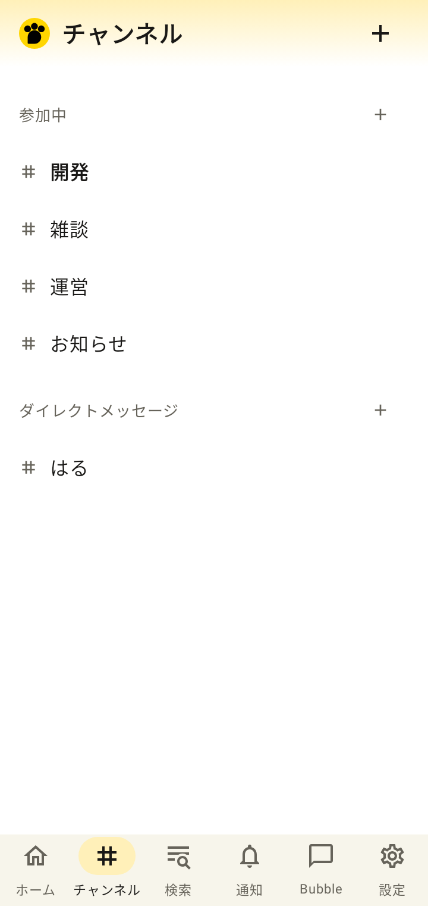
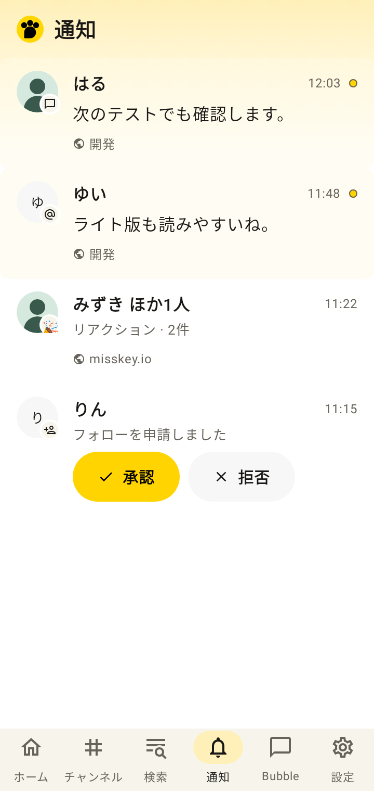
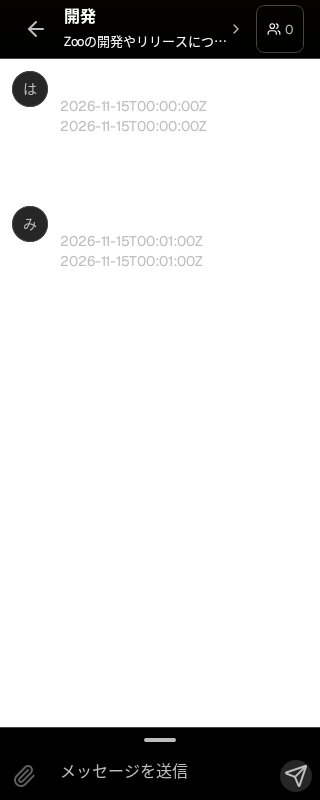
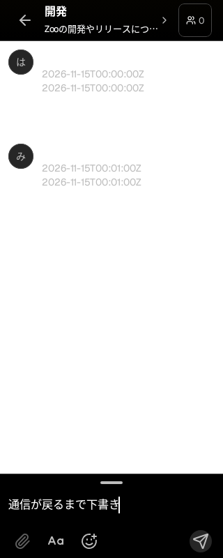

# Android のデザイン規則

Androidの見た目を変更するときの基準。数値の定義元は
`frontend-compose/src/commonMain/kotlin/zoo/AndroidDesign.kt`、実装時の手順は
[android-designスキル](../.agents/skills/android-design/SKILL.md)に置く。

## 画面と操作の方針

- ライト・ダークは端末のテーマ設定に追従できるようにする。Zooの黄色は主操作と選択状態に使う。ヘッダーだけに黄色の光を入れ、投稿と会話の本文面は無彩色にする。
- 投稿・会話・通知は用途に応じて余白と区切り線で整理する。通知元や未読表示は通知で使う。通話やログインのように主操作が少ない画面では中央に内容幅のボタンを置く。
- 下部のホーム・チャンネル・通知・Bubble・設定は各トップに置く。チャンネルの会話、スレッド、投稿詳細などの子画面はAndroidの戻る操作を使う。
- チャンネル名をタップするとチャンネルの設定を開く。名前は16sp、説明は13spの通常ウェイトで一行を超えたら末尾を省略する。管理操作は管理権限を確認する。
- ホームと会話のヘッダーは読み進めると引っ込み、逆方向のスクロールで戻る。投稿ボタンと会話入力の位置は、ヘッダー表示とは独立して管理する。

### UIを先に組む

合意画像を基準にComposeのレイアウトと部品を作り、サンプルの表示データで撮影する。近い旧画面を出発点にすると、旧ボタンや枠、過剰な余白が設計に持ち込まれるので、UIの状態と操作を定義してから既存ロジックを調べる。接続は表示データと操作コールバックを渡すアダプターに置く。接続後も同じ状態を撮影し、合意画像と照合する。

### 画面ごとの基準

| 画面 | 構成・操作 |
| --- | --- |
| ホーム | タブの下に枠なしのタイムライン。本文サイズを保ち、投稿を罫線で区切る。鉛筆アイコンで投稿を開く。 |
| ホーム投稿 | 本文と添付のプレビューを同じ下書きに置く。下から最近の写真を出し、OSの写真ピッカーへの入口も提供する。 |
| チャンネル一覧 | 上部の検索入口、参加中の一覧、DMの順。各行は名前と一行の補助情報、必要な未読表示で構成する。 |
| 会話・スレッド | 上部のチャンネル名から設定を開く。会話には下部タブを出さず、入力欄を画面端に配置する。スレッドを閉じたときは元の位置へ戻る。 |
| 通知 | 送信者、通知の種類、会話名を読み順に置く。利用できる返信元や画像を補助情報として出す。未読ラベルを使う。 |
| Bubble | 入力中の内容が共有されることを伝え、入力欄を下に配置する。 |
| 設定 | トップにテーマ、言語、各設定の入口を置く。子画面は下部タブを隠す。 |
| 通話・ログイン | 主要操作は中央の内容幅のボタンにする。応答・終了・ログインのように結果が重要な操作は文字を付ける。 |

新規画面にも同じルールを適用する。機能別の実キャプチャを新規・変更時のPRに添付する。上部の光、操作列、一覧の枠、戻り先などを設計と実画面で見比べる。

### 画面設計と実機で確認する項目

- 会話では左スワイプで返信、長押しで文脈操作。動かしている対象が指に追従し、確定位置で一度だけ触覚を返す。画面端はOSの戻る操作に優先権を渡す。TalkBackに同じ操作を提供する。
- スレッドに入る・戻る動きは方向を揃え、元の位置を保持する。動きを減らす端末設定に従う。
- ホーム投稿では、アプリ内で許可済みの最近の写真を選び、必要ならAndroidの写真ピッカーで選び直せる。どちらも既存の下書き・添付処理に接続する。
- 初回ログインは認可コードとPKCE、Custom Tabsと検証済みApp Linksで同じ端末上で完了できる形を目指す。認証サービスの戻り先を登録し、初回起動・中断・再試行を確認する。
- 通知は返信元、会話名、添付を必要に応じて表示する。通知シェードの返信・既読やロック画面での公開範囲はAndroidの設定に従う。

## 数値と用途

| 用途 | 基準 | 所有する部品・定義 |
| --- | --- | --- |
| 基本の間隔 | 4 / 8 / 12 / 16 / 24dp | `AndroidDesign`。4:密接、8:操作内、12:項目内、16:画面、24:セクション間 |
| 通知・投稿の内側 | 左右・上下12dp | `NotificationCard` / `HomePostCard` / `Message`。チャット左右は`MessageList`が所有 |
| 著者のアバター / 本文まで | 36dp / 12dp | `postAvatarSize` / `avatarGap`。装飾の表示サイズであり操作の最小サイズではない |
| ヘッダー | 最小56dp、左右12dp、上下4dp | `PaneHeader`。タイトル20sp/28sp。内容に合わせて伸びる |
| ボタン・入力・メニュー・一覧操作 | 最小48dp | `touchTargetSize`、共通UI。ナビゲーション行の間隔は0dp |
| 操作アイコン | 24dp | `Button` / `IconButton`。バッジ・本文中の装飾は対象外 |
| ボタン内側 / アイコンとラベル間 | 左右12dp / 8dp | `Button`。アイコンだけのボタンは48dpの中央配置 |
| 入力内側 | 左右12dp・上下8dp | `Field`。先頭アイコン付きは開始44dp、用途固有の明示的な`contentPadding`は維持 |
| 設定画面外側 / セクション間 | 16dp / 24dp | `ZooSettings`。設定行内側は左右16dp・上下12dp |
| ボタンの見える背景 | 補助操作は必要に応じて32dp、主操作・枠付き操作は最小48dp | `AndroidAction`。文字ボタンは内容幅、主操作のアイコンボタンは円形 |
| 操作の角丸 / 面の角丸 | 円とカプセル、入力は12dp、検索はカプセル | `AndroidAction`、`androidInputDecoration` |
| 本文 | 17sp / 行高25sp | `ZooTheme.bodyMedium` |
| 説明・日時 | 14sp / 行高20sp | `ZooTheme.bodySmall`、`PostTimestamp` |
| 入力 | 16sp / 行高24sp | `Field` |
| 操作ラベル / 小さなバッジ | 15sp / 12sp | `Button` / `labelSmall`。本文をバッジ用サイズにしない |

高さは最小値。大きな文字を固定高で切らない。画面やパネルの利用可能幅に合わせ、
設定行は480dp未満で説明と操作を上下に置く。画面の切替は既存の768/1024dpを維持する。
追加するUIではこの規則を使い、親のpaddingを含めた実際の位置を確認する。

## ボタンの表示サイズと操作領域

アイコンは24dp。補助操作はアイコンだけか淡い面、主操作は黄色の円またはカプセルで示す。タップ領域は透明な周辺を含めて確保する。文字ボタンは文字幅に合わせた背景を操作領域の中央へ置く。文字倍率が大きい場合は背景も文字を収める高さに広げる。
隣り合う操作領域は重ねない。

[WCAG 2.2のTarget Size (Minimum)](https://www.w3.org/WAI/WCAG22/Understanding/target-size-minimum/)
には24×24 CSS pxというWeb向けの基準がある。Androidの物理pxやdpの規則とは区別し、
Android公式の「24dpのアイコンと48dpのタッチ領域を分ける」例を採用する。

ホーム投稿の下では、返信・再投稿・リアクションの件数を小さなアイコンと数字で表示する。操作は長押しの下部メニューと読み上げのカスタムアクションに置く。既存リアクションの選択状態は本文と区別する。

## チャンネルの入力

待機時は添付・本文・送信を一段にまとめる。入力欄にフォーカスすると本文と下段の操作列（添付・書式・絵文字・送信）に分ける。
画面との間に外側paddingを設けず、左右・下端に密着させる。二重の枠は置かず、本文と操作の内側だけに余白を置く。
上端の24dp高の帯にあるつまみをタップするか上へスワイプすると全画面へ展開する。全画面でも操作列は下端に置き、つまみをタップ・下へスワイプするか戻る操作で縮める。
つまみにはTalkBackから呼べる展開・縮小のカスタムアクションも用意する。
本文のスクロールでは展開しない。

共通の`Field`を使い、本文・選択範囲・変換状態は外側の`FieldEditingState`に保持する。
添付の所有者も表示の切り替えで作り直さない。
新しい送信経路やタイマーは追加しない。オンライン復帰待ちの入力、未参加・アーカイブ・
暗号化チャンネルの既存制約、送信失敗時の下書き・添付の復元は維持する。
送信成功時、続きの下書きがなければ縮小する。

Aaから太字・斜体・取り消し線・コードブロックを選べる。既存のMFM記法を選択部分へ挿入し、
未選択なら記法の内側にカーソルを置く。太字と斜体はMFMの三連アスタリスク装飾との衝突を
避けるためタグを使う。コードブロックを含む選択へのコード指定は無効にし、既存の柵を壊さない。
IME変換中は書式と絵文字の挿入を無効にする。絵文字も選択範囲を置換する。

チャンネルとスレッドは同じ入力部品を使う。Homeの投稿とBubble Chatはスワイプ展開の対象外。

## 色と状態

既存の `zooColorScheme` と `MaterialTheme.colorScheme` を使う。
本文・背景は `onBackground` / `background`、面は `surface`、補助情報は
`onSurfaceVariant`、境界は `outline`、選択は `secondaryContainer`、
エラーは `error`、リンクは `LocalLinkColor`。黄色のブランド色は主要操作に使い、
すべての面や補助操作へ広げない。色に加えてラベル・選択状態・無効状態をセマンティクスに渡す。
新しい画面の都合で独自の色や透明度を追加せず、共通部品の状態表現を使う。

## 参考資料と採用した判断

2026-11-17に確認。以下のアプリや資料から方針を参照し、Zooの数値として上表を定めた。
他アプリの寸法を実測した値ではなく、コードのコピーも行っていない。

- [Material: Spacing methods](https://m2.material.io/design/layout/spacing-methods.html): 4/8dp刻みと、視覚サイズ・操作領域を分ける考え方。
- [Android: Touch target size](https://support.google.com/accessibility/android/answer/7101858?hl=en): 最小48×48dp。独立した小ボタンには8dpの間隔を優先し、一覧の行は48dp以上の重ならない領域として扱う。
- [Now in Android: Button](https://github.com/android/nowinandroid/blob/2982e63cb691ad49cd009aab43dc206fee6699c2/core/designsystem/src/main/kotlin/com/google/samples/apps/nowinandroid/core/designsystem/component/Button.kt): アプリのボタンを共通部品で所有し、状態と余白をまとめる構造。
- [Element / Compound: TypographyTokens](https://github.com/element-hq/compound-android/blob/9f93a46deee4e0d6f4771f9001bdea2fc09d356d/compound/src/main/kotlin/io/element/android/compound/tokens/generated/TypographyTokens.kt): メッセンジャーの文字を役割別トークンとして管理する構造。Zooの本文17spは既存方針を維持する。
- [Slack: Customize the mobile app](https://slack.com/help/articles/29788684062739-Customize-the-Slack-mobile-app): 主要な行き先をまとめる方針の参考。Zooの既存のラベル付きナビゲーションを維持する。Slackのpadding値の根拠には使わない。
- [frontend-consistency](../.agents/skills/frontend-consistency/SKILL.md): 共通UI、翻訳、テーマ、配置先に応じたレイアウト。
- [storybook-coverage](../.agents/skills/storybook-coverage/SKILL.md): 実部品の状態・操作を確認する方針。AndroidはComposeテストを使う。

## 今回の適用範囲と例外

Androidの全画面に適用する。共通部品と主要画面を更新した後、添付・画像プレビュー、プロフィール、管理画面などの子画面も個別に合意画像と照合する。照合結果は実キャプチャとともにPRに記録する。
1dpの境界、画像比率、進捗表示、文字の基線やMFMの組版はレイアウト用4dp刻みの対象外。

Android専用の変更で共有APIの契約が変わらない場合、React・TUI・デスクトップへの追従は不要。

## 検証

[Androidの手順](android.md#ビルド)でビルド・単体テスト・lintを実行する。
`ReviewRegressionUiTest.homeAndChannelAuthorsShareTheAvatarGutterAndTopAlignment` は
320/440dpで通知・投稿の本文開始位置、投稿の左右位置・36dpアバター・グループ本文の開始位置と
Homeのプロフィールリンクの48dp操作領域を検査する。
`ComposerFormattingTest` は日本語・逆向き選択・入れ子・コードブロック・絵文字の挿入を検査する。
`ReviewRegressionUiTest.channelComposerSwipesToFullScreenAndPreservesSelectedJapaneseText` は
スワイプ展開・縮小、選択した日本語への書式、戻る操作、オフラインの制約を検査する。
`TouchUiTest` は320/600dp、明暗、大きな日本語入力、48dpタッチ領域、無効状態を検査し、
共通部品のデザイン確認用キャプチャも保存する。
実機のIME・TalkBack・配布前の画面確認は別途行う。テスト追加だけを検証済みとは扱わない。

## 表示確認用キャプチャ

画面別のデザインモック、Compose 実キャプチャ、再生成手順は [UI デザインサンプル](android-design-samples.md) にまとめる。

Robolectric / API 35で実際のCompose部品を描画したキャプチャ。
主要画面は実際のComposeとローカルのテストデータで撮影しています。

| ホーム | チャンネル | 通知 |
| --- | --- | --- |
|  |  |  |

| Bubble | 設定 | スレッド |
| --- | --- | --- |
|  |  |  |

320dp幅のテスト用の会話と下書きを表示する。OSのIMEはRobolectricのキャプチャに含まれない。

| 待機中 | 入力中 | 全画面入力・書式 |
| --- | --- | --- |
|  |  |  |

[320dpの下部ナビ](images/android-design/navigation-320-light.png)と
[600dp・ダークの下部ナビ](images/android-design/navigation-600-dark.png)も参照。

[320dp・明るいテーマ](images/android-design/primitives-320-light.png)、
[320dp・文字倍率180%・暗いテーマ](images/android-design/primitives-320-large-text-dark.png)、
[600dp・暗いテーマ](images/android-design/primitives-600-dark.png)も保存する。
