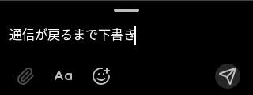

# Android のデザイン規則

Androidの見た目を変更するときの基準。数値の定義元は
`frontend-compose/src/commonMain/kotlin/zoo/AndroidDesign.kt`、実装時の手順は
[android-designスキル](../.agents/skills/android-design/SKILL.md)に置く。

## 基準にする画面

通知一覧の各通知を基準とする（ユーザー指定）。アバター、本文、文脈、補助情報が
一定の余白で並ぶ構成をHomeとチャンネルにも使う。通知固有の未読表示や枠を
すべての投稿へ追加するものではない。

通知の既存レイアウトは内側12dp、アバター40dp、本文との間隔12dp。
通知一覧自体の外側16dpとカード間12dpは維持する。
Homeとチャットは連続するフィードなので、カードの外側余白を重ねず、投稿内の12dpを使う。
Homeのプロフィールリンクは48dpの操作領域を確保し、残りの間隔を4dpにすることで
表示上の40+12dpを維持する。
グループ化したチャットは40+12dpの著者列を維持し、同一著者の途中に上下余白を足さない。

## 数値と用途

| 用途 | 基準 | 所有する部品・定義 |
| --- | --- | --- |
| 基本の間隔 | 4 / 8 / 12 / 16 / 24dp | `AndroidDesign`。4:密接、8:操作内、12:項目内、16:画面、24:セクション間 |
| 通知・投稿の内側 | 左右・上下12dp | `NotificationCard` / `HomePostCard` / `Message`。チャット左右は`MessageList`が所有 |
| 著者のアバター / 本文まで | 40dp / 12dp | `postAvatarSize` / `avatarGap`。装飾の表示サイズであり操作の最小サイズではない |
| ヘッダー | 最小56dp、左右12dp、上下4dp | `PaneHeader`。タイトル20sp/28sp。内容に合わせて伸びる |
| ボタン・入力・メニュー・一覧操作 | 最小48dp | `touchTargetSize`、共通UI。ナビゲーション行の間隔は0dp |
| 操作アイコン | 24dp | `Button` / `IconButton`。バッジ・本文中の装飾は対象外 |
| ボタン内側 / アイコンとラベル間 | 左右12dp / 8dp | `Button`。アイコンだけのボタンは48dpの中央配置 |
| 入力内側 | 左右12dp・上下8dp | `Field`。先頭アイコン付きは開始44dp、用途固有の明示的な`contentPadding`は維持 |
| 設定画面外側 / セクション間 | 16dp / 24dp | `ZooSettings`。設定行内側は左右16dp・上下12dp |
| ボタンの見える背景 | アイコン操作は32dp、文字操作は内容幅・最小32dp高 | 48dpの透明な操作領域内に配置。大きな文字では背景も広がる |
| 操作の角丸 / 面の角丸 | 8dp / 12dp | ボタン・入力 / 設定セクション。アバターの円形は維持 |
| 本文 | 17sp / 行高25sp | `ZooTheme.bodyMedium` |
| 説明・日時 | 14sp / 行高20sp | `ZooTheme.bodySmall`、`PostTimestamp` |
| 入力 | 16sp / 行高24sp | `Field` |
| 操作ラベル / 小さなバッジ | 15sp / 12sp | `Button` / `labelSmall`。本文をバッジ用サイズにしない |

高さは最小値。大きな文字を固定高で切らない。画面やパネルの利用可能幅に合わせ、
設定行は480dp未満で説明と操作を上下に置く。画面の切替は既存の768/1024dpを維持する。
追加するUIではこの規則を使い、親のpaddingを含めた実際の位置を確認する。

## ボタンの表示サイズと操作領域

アイコンは24dp、アイコン操作の背景は32dpを基準にする。48dpは透明な周辺部分を含む
操作領域であり、48dp全体を塗る指示ではない。文字ボタンは文字幅に合わせた背景を
操作領域の中央へ置く。文字倍率が大きい場合は背景も文字を収める高さに広げる。
隣り合う操作領域は重ねない。

[WCAG 2.2のTarget Size (Minimum)](https://www.w3.org/WAI/WCAG22/Understanding/target-size-minimum/)
には24×24 CSS pxというWeb向けの基準がある。Androidの物理pxやdpの規則とは区別し、
Android公式の「24dpのアイコンと48dpのタッチ領域を分ける」例を採用する。

Home投稿下のアクションは、ボタン内の左右余白とアイコン・件数間を
`spaceSmall`（4dp）にする。通常の文字ボタンの12dp余白より密に配置し、
アイコン24dpと最小48dpのタッチ領域は維持する。列全体は横幅に合わせて均等配置し、
幅が足りない場合は折り返す。三点メニューも同じ列に置く。

## チャンネルの入力

下部の入力欄は本文と下段の操作列（添付・Aa・絵文字・送信）に分ける。
画面との間に外側paddingを設けず、左右・下端に密着させる。二重の枠は置かず、本文と操作の内側だけに余白を置く。
上端の24dp高の帯にあるつまみを上へスワイプすると全画面へ展開し、全画面のつまみを
下へスワイプするか戻る操作で縮める。展開用のボタンは置かない。
つまみにはTalkBackから呼べる展開・縮小のカスタムアクションも用意する。
本文のスクロールでは展開しない。

共通の`Field`を使い、本文・選択範囲・変換状態は外側の`FieldEditingState`に保持する。
添付の所有者も表示の切り替えで作り直さない。
新しい送信経路やタイマーは追加しない。オンライン復帰待ちの入力、未参加・アーカイブ・
暗号化チャンネルの既存制約、送信失敗時の下書き・添付の復元は維持する。
送信成功時、続きの下書きがなければ縮小する。

Aaから太字・斜体・取り消し線・コードブロックを選べる。既存のMFM記法を選択部分へ挿入し、
未選択なら記法の内側にカーソルを置く。太字と斜体はMFMの三連アスタリスク装飾との衝突を
避けるためタグを使う。コードブロックを含む選択へのコード指定は無効にし、既存の柵を壊さない。
IME変換中は書式と絵文字の挿入を無効にする。絵文字も選択範囲を置換する。

チャンネルとスレッドは同じ入力部品を使う。Homeの投稿とBubble Chatはスワイプ展開の対象外。

## 色と状態

既存の `zooColorScheme` と `MaterialTheme.colorScheme` を使う。
本文・背景は `onBackground` / `background`、面は `surface`、補助情報は
`onSurfaceVariant`、境界は `outline`、選択は `secondaryContainer`、
エラーは `error`、リンクは `LocalLinkColor`。黄色のブランド色は主要操作に使い、
すべての面や補助操作へ広げない。色に加えてラベル・選択状態・無効状態をセマンティクスに渡す。
新しい画面の都合で独自の色や透明度を追加せず、共通部品の状態表現を使う。

## 参考資料と採用した判断

2026-11-17に確認。以下のアプリや資料から方針を参照し、Zooの数値として上表を定めた。
他アプリの寸法を実測した値ではなく、コードのコピーも行っていない。

- [Material: Spacing methods](https://m2.material.io/design/layout/spacing-methods.html): 4/8dp刻みと、視覚サイズ・操作領域を分ける考え方。
- [Android: Touch target size](https://support.google.com/accessibility/android/answer/7101858?hl=en): 最小48×48dp。独立した小ボタンには8dpの間隔を優先し、一覧の行は48dp以上の重ならない領域として扱う。
- [Now in Android: Button](https://github.com/android/nowinandroid/blob/2982e63cb691ad49cd009aab43dc206fee6699c2/core/designsystem/src/main/kotlin/com/google/samples/apps/nowinandroid/core/designsystem/component/Button.kt): アプリのボタンを共通部品で所有し、状態と余白をまとめる構造。
- [Element / Compound: TypographyTokens](https://github.com/element-hq/compound-android/blob/9f93a46deee4e0d6f4771f9001bdea2fc09d356d/compound/src/main/kotlin/io/element/android/compound/tokens/generated/TypographyTokens.kt): メッセンジャーの文字を役割別トークンとして管理する構造。Zooの本文17spは既存方針を維持する。
- [Slack: Customize the mobile app](https://slack.com/help/articles/29788684062739-Customize-the-Slack-mobile-app): 主要な行き先をまとめる方針の参考。Zooの既存のラベル付きナビゲーションを維持する。Slackのpadding値の根拠には使わない。
- [frontend-consistency](../.agents/skills/frontend-consistency/SKILL.md): 共通UI、翻訳、テーマ、配置先に応じたレイアウト。
- [storybook-coverage](../.agents/skills/storybook-coverage/SKILL.md): 実部品の状態・操作を確認する方針。AndroidはComposeテストを使う。

## 今回の適用範囲と例外

共通操作部品、ヘッダー、Home投稿、チャット・入力欄、通知、設定の主要レイアウトに適用する。
通知は既存の12/40/12をトークンへ移し、スマートフォンの見た目を維持する。
Androidでは広い配置先でも著者のアバターを40dpへ揃える。
ログイン、添付・画像プレビュー、MFM装飾、個別のプロフィール・管理画面の全寸法は今回一括変更しない。
これらを変更する際に同じ規則へ寄せる。1dpの境界、画像比率、進捗表示、文字の基線や
MFMの組版はレイアウト用4dp刻みの対象外。

React・TUI・デスクトップの寸法は変更しない。Androidのタッチ表示だけの変更で、API・通信・
データ構造・機能差分はないためTUIへの追従変更は不要。

## 検証

[Androidの手順](android.md#ビルド)でビルド・単体テスト・lintを実行する。
`ReviewRegressionUiTest.homeAndChannelAuthorsShareTheAvatarGutterAndTopAlignment` は
320/440dpで通知・投稿の本文開始位置、投稿の左右位置・40dpアバター・グループ本文の開始位置と
Homeのプロフィールリンクの48dp操作領域を検査する。
`ComposerFormattingTest` は日本語・逆向き選択・入れ子・コードブロック・絵文字の挿入を検査する。
`ReviewRegressionUiTest.channelComposerSwipesToFullScreenAndPreservesSelectedJapaneseText` は
スワイプ展開・縮小、選択した日本語への書式、戻る操作、オフラインの制約を検査する。
`TouchUiTest` は320/600dp、明暗、大きな日本語入力、48dpタッチ領域、無効状態を検査し、
共通部品のデザイン確認用キャプチャも保存する。
実機のIME・TalkBack・配布前の画面確認は別途行う。テスト追加だけを検証済みとは扱わない。

## 表示確認用キャプチャ

Robolectric / API 35で実際のCompose部品を描画したキャプチャ。
入力はモックの日本語下書きで、会話一覧・システムのIMEは含まない。
通常入力は部品の範囲、全画面は320dp幅の表示領域全体を保存する。

| 通常入力・320dp | 全画面・書式操作・320dp |
| --- | --- |
|  |  |

[320dp・明るいテーマ](images/android-design/primitives-320-light.png)、
[320dp・文字倍率180%・暗いテーマ](images/android-design/primitives-320-large-text-dark.png)、
[600dp・暗いテーマ](images/android-design/primitives-600-dark.png)も保存する。
