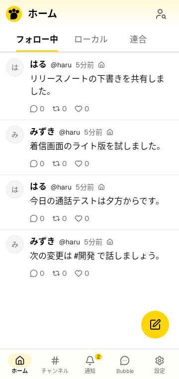
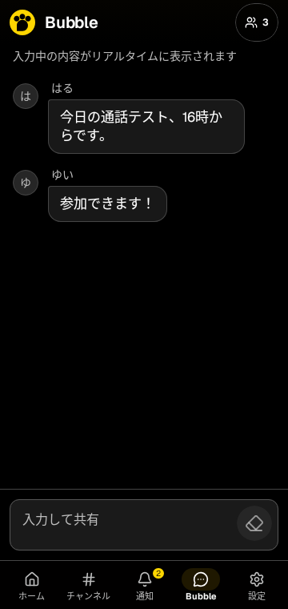
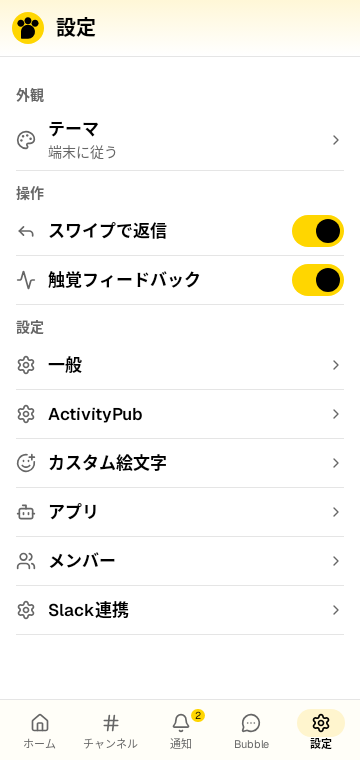
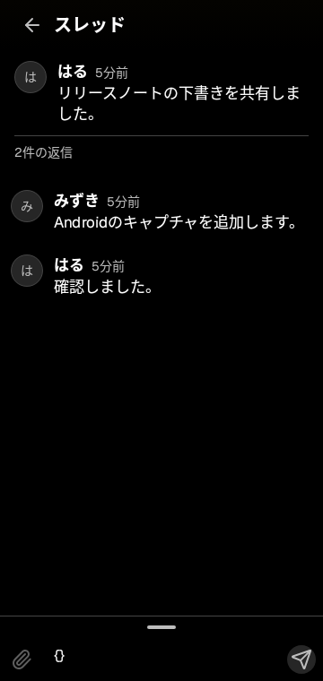
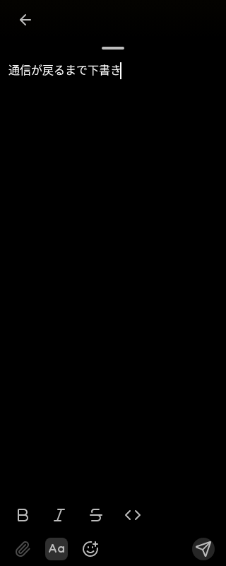

# Android のデザイン規則

Androidの見た目を変更するときの基準。数値の定義元は
`frontend-compose/src/commonMain/kotlin/zoo/AndroidDesign.kt`、実装時の手順は
[android-designスキル](../.agents/skills/android-design/SKILL.md)に置く。

## 画面と操作の方針

- ライト・ダークは端末のテーマ設定に追従できるようにする。Zooの黄色は主操作と選択状態に使う。ヘッダーだけに黄色の光を入れ、投稿と会話の本文面は無彩色にする。
- 画面全体で項目間の区切り線を省き、余白と見出しでまとまりを示す。通知元や未読表示は通知で使う。通話やログインのように主操作が少ない画面では中央に内容幅のボタンを置く。
- 下部のホーム・チャンネル・検索・通知・Bubble・設定は各トップに置く。検索のタブは全文検索を開き、前回の語と種類を引き継ぐ。チャンネルの会話、スレッド、投稿詳細などの子画面はAndroidの戻る操作を使う。
- 会話ヘッダーのチャンネル名と右向きの矢印を一つの操作領域にし、タップするとチャンネルの設定を開く。名前は16sp、説明は13spの通常ウェイトで一行を超えたら末尾を省略する。管理操作は管理権限を確認する。
- ホームと会話のヘッダーは一覧に重ね、読み進めると引っ込み、逆方向のスクロールで戻る。ヘッダーの表示・非表示で一覧の表示領域は変わらない。投稿ボタンと会話入力の位置は、ヘッダー表示とは独立して管理する。

### 画面遷移とキャッシュ

- タップや戻る操作で行き先が決まったら、通信やキャッシュの読み出しを待たずに遷移先を表示する。一覧で取得済みの投稿本文・送信者・チャンネル名などは初回描画に使い、返信や履歴などの不足分は遷移先で読み込む。
- キャッシュが空なら遷移先のヘッダーと読み込み状態を表示する。更新中も表示できる内容と操作を残し、取得に失敗した箇所に再試行を用意する。削除や閲覧権限の喪失が確認できた内容は表示とキャッシュから除く。
- 画面遷移用のメモリキャッシュはアカウント単位で管理し、ログアウトで破棄する。設定の「画面遷移キャッシュ」で、Home・投稿詳細・プロフィールの合計とチャンネルそれぞれの保持件数を0・4・8・16件から選べる。既定は各8件。一覧の取得済みデータと同期クライアントのオフライン保存は引き続き利用できる。
- 添付画像キャッシュは、設定からオフ・128 MiB・256 MiB・512 MiB・1 GiB・2 GiBを選べる。既定は512 MiB。容量を縮小すると利用の古い画像から削除し、オフにすると保存済みの添付画像を削除する。公開画像には別のキャッシュを使う。
- 通信が遅い場合、キャッシュが空の場合、同じ画面に戻る場合を確認する。連続操作で前に開いた画面への応答が遅れても、現在の画面の内容を上書きしない。

### 投稿画像とリンクプレビュー

APubの画像は1枚なら元の幅:高さを3:4〜16:9に収める。2枚以上は全体を16:9にし、2枚は左右、3枚は左1枚・右2段、4枚は2×2とする。5枚以上は右下に残りの枚数を重ねる。チャンネルでは元の縦横比を保って本文の左端に揃え、高さ上限まで縮小して全体を見せる。複数枚は同じ行を横にスクロールする。どちらも読み込み前から画像枠を確保し、使える場合はBlurHashを表示する。TLとチャンネルのセンシティブ画像には、画像内右上に表示切り替えを置く。全画面では目のボタンを省き、未表示のセンシティブ画像はぼかしをタップすると表示する。

画像をタップすると選んだ画像から全画面で開く。画像名は表示せず、横ドラッグで同じ投稿の前後の画像へ移動し、上下のドラッグで会話に戻る。ドラッグ中は画像を指に追従させる。Summalyの画像は周囲の余白と枠線を置かず、サイト名は1行、タイトルは2行、説明は3行までで省略する。

### UIを先に組む

合意画像を基準にComposeのレイアウトと部品を作り、サンプルの表示データで撮影する。近い旧画面を出発点にすると、旧ボタンや枠、過剰な余白が設計に持ち込まれるので、UIの状態と操作を定義してから既存ロジックを調べる。接続は表示データと操作コールバックを渡すアダプターに置く。接続後も同じ状態を撮影し、合意画像と照合する。

### 画面ごとの基準

| 画面 | 構成・操作 |
| --- | --- |
| ホーム | タブの下に枠なしのタイムライン。本文サイズを保ち、投稿は余白で分ける。投稿の1行目は表示名・IDを左、日時・公開範囲を右に置く。2行目に #チャンネル名、または端に向かって色が薄れる1行の帯でサーバー名を表示する。連合先がテーマカラーを公開していれば帯に使う。各投稿の下に返信・リノート・リアクション追加・その他を本文の左右端に合わせて等間隔で並べる。鉛筆アイコンで投稿を開く。投稿作成の上部で公開範囲を選び、ActivityPubロゴで連合配信を切り替える。オンはロゴ本来の色、オフはグレーで表示する。 |
| ホーム投稿 | 本文と添付のプレビューを同じ下書きに置く。下から最近の写真を出し、OSの写真ピッカーへの入口も提供する。操作バーの四辺に8dpの内側余白を設ける。 |
| チャンネル一覧 | 参加中の一覧、DMの順。ヘッダー右上の＋から「チャンネルを探す」と「チャンネルを作成」を選ぶメニューを開く（一覧の上に検索欄は置かない）。各見出しの横でもチャンネルとDMの作成に＋アイコンを使う。チャンネルとDMは名前を1行で表示する。チャンネル名は未読時に700、個人DMのユーザー名は500で表示する。未読状態は読み上げにも渡す。説明文と行間の区切り線を省き、通常の行高は48dpにそろえる。 |
| 検索 | 下のナビゲーションのタブ。検索欄、絞り込みの列、暗号化チャンネルが対象外である旨、結果の順。絞り込みの列は横にスクロールするカプセル（表示36dp、タップ領域48dp）で、先頭の種類は選んでいる種類（既定は「すべて」）を出し、押すとメニューで「すべて」「メッセージ」「ファイル」から1つ選ぶ。送信者・チャンネルは下部シート（検索欄とチェックボックス）を開き、「自分が参加中」「ボットを除く」は押すたびに切り替える。使っている絞り込み（「すべて」以外の種類を含む）は淡い黄色（`headerLight`）の面と600で示し、使っていないものは輪郭だけにする。結果は投稿者・日時・抜粋（検索語を強調）・チャンネルを表示し、押すとそのメッセージへ移動する。結果から戻ると語・種類・絞り込み・一覧の位置を残す。 |
| 会話・スレッド | 上部のチャンネル名から設定を開く。会話には下部タブを出さず、入力欄を画面端に配置する。スレッドを閉じたときは元の位置へ戻る。チャンネル直下には端末のローカル日付の区切りと、未読の先頭を示す区切りを表示する。 |
| 通知 | 送信者、通知の種類、会話名を読み順に置く。利用できる返信元や画像を補助情報として出す。未読はドットと読み上げ状態で示す。通知画面に表示した項目を自動で既読にし、既読操作のボタンは置かない。 |
| Bubble | 入力中の内容が共有されることを伝え、入力欄を下に配置する。 |
| 設定 | トップにテーマ、言語、各設定の入口を置く。行やセクションの区切り線を省き、見出しと余白で項目をまとめる。更新・バージョン情報と通知の権限設定は設定の子画面に置く。子画面は下部タブを隠す。 |
| 通話・ログイン | 主要操作は中央の内容幅のボタンにする。セッション復元中もログイン画面のレイアウトを使い、Zoo マークの下に小さな進捗表示を置く。着信時は下部左に緑の応答、右に赤の拒否を並べる。ロック画面の着信も共通の通話画面を使う。通話の最小化、対応端末でのPiP、全画面着信の設定入口を設ける。同じ大きさの円に白い電話アイコンを置き、その下に小さなラベルを添える。ログインなど結果が重要な操作にも文字を付ける。通話は中央に相手のアバターを表示する。着信中は2つの波紋が間隔を空けて広がり、接続後は相手の受信音声レベルで波紋の広がりと濃さを変える。無音時と端末で動きを減らす設定が有効な場合は静止する。 |

新規画面にも同じルールを適用する。機能別の実キャプチャを新規・変更時のPRに添付する。上部の光、操作列、一覧の枠、戻り先などを設計と実画面で見比べる。

### 画面設計と実機で確認する項目

- 会話では左スワイプで返信、長押しで文脈操作。動かしている対象が指に追従し、確定位置で一度だけ触覚を返す。画面端はOSの戻る操作に優先権を渡す。TalkBackに同じ操作を提供する。
- スレッドに入る・戻る動きは方向を揃え、元の位置を保持する。動きを減らす端末設定に従う。
- ホーム投稿では、アプリ内で許可済みの最近の写真を選び、必要ならAndroidの写真ピッカーで選び直せる。どちらも既存の下書き・添付処理に接続する。
- 初回ログインは認可コードとPKCE、Custom Tabsと検証済みApp Linksで同じ端末上で完了できる形を目指す。認証サービスの戻り先を登録し、初回起動・中断・再試行を確認する。
- 通知は返信元、会話名、添付を必要に応じて表示する。通知シェードの返信・既読やロック画面での公開範囲はAndroidの設定に従う。

## 数値と用途

| 用途 | 基準 | 所有する部品・定義 |
| --- | --- | --- |
| 基本の間隔 | 4 / 8 / 12 / 16 / 24dp | `AndroidDesign`。4:密接、8:操作内、12:項目内、16:画面、24:セクション間 |
| 通知・投稿の内側 | 左右・上下12dp | `NotificationCard` / `HomePostCard` / `Message`。チャット左右は`MessageList`が所有 |
| 著者のアバター / 本文まで | 36dp / 12dp | `postAvatarSize` / `avatarGap`。装飾の表示サイズであり操作の最小サイズではない |
| ヘッダー | 最小56dp、左右12dp、上下4dp | `PaneHeader`。タイトル20sp/28sp。内容に合わせて伸びる |
| ボタン・入力・メニュー・一覧操作 | 最小48dp | `AndroidControlSize.target`。隣接する操作領域は重ねない。 |
| 操作アイコン | 単独24dp、文字に並ぶ操作16dp、補助情報12dp | `UiGlyph` と `AndroidControlSize`。個別画面に定義があるものはその基準に従う |
| 文字ボタン内側 | 左右16dp（文字のみ24dp）・上下8dp | `TextAction`。通常の高さは48dp、幅は内容に合わせる |
| 入力内側 | 左右12dp・上下8dp | `Field`。先頭アイコン付きは開始44dp、用途固有の明示的な`contentPadding`は維持 |
| 設定画面外側 / セクション間 | 16dp / 24dp | `ZooSettings`。設定行内側は左右16dp・上下12dp |
| 背景付きアイコンボタン | 48dpの円 | `UiIconButton`。透明な補助ボタンと同じ操作領域 |
| 下部タブ | 高さ60dp、選択の背景48×32dp | `AndroidShell`。タブ全体を操作領域にする |
| 操作の角丸 / 面の角丸 | 円とカプセル、入力は12dp、検索はカプセル | `AndroidAction`、`androidInputDecoration` |
| 本文 | 17sp / 行高25sp | `ZooTheme.bodyMedium` |
| 説明・日時 | 14sp / 行高20sp | `ZooTheme.bodySmall`、`PostTimestamp` |
| 入力 | 16sp / 行高24sp | `Field` |
| 操作ラベル / 小さなバッジ | 15sp / 12sp | `Button` / `labelSmall`。本文をバッジ用サイズにしない |

高さは最小値。大きな文字を固定高で切らない。画面やパネルの利用可能幅に合わせ、
設定行は480dp未満で説明と操作を上下に置く。画面の切替は既存の768/1024dpを維持する。
追加するUIではこの規則を使い、親のpaddingを含めた実際の位置を確認する。

## 複数画面で使う部品

- 全文検索、チャンネル・ユーザー検索、共有先、絵文字、検索フィルターには `SearchInput` を使う。背景と角丸、左の虫眼鏡、16spの入力文字、入力中のクリアボタンを揃える。全文検索のIME検索と、候補一覧の入力による絞り込みは呼び出し側が扱う。
- 設定・共有先・選択候補には `LabeledRow` を使う。行全体に操作を付け、左右16dpの内側に主ラベルと補足を配置する。右側には操作に応じて矢印、スイッチ、選択状態を表示する。
- ホームのタイムラインと共有先の種類の切り替えには `ScopeTab` を使う。選択中は淡いテーマ色と太字で示し、選択状態を読み上げにも渡す。

- 投稿操作・リノート・共有先・検索フィルター・絵文字のボトムシートは `ActionSheet` で背景・前景・つまみを揃える。展開状態と最大幅は画面に合わせる。投稿メニューの項目は設定や共有先と同じ `LabeledRow` を使う。
- タイムライン（引用を含む）・通知・プロフィール・通話・チャンネルリンク・検索フィルターの人物表示には `UserAvatar` を使う。写真は円形に切り抜き、代替の頭文字は結合文字や絵文字を含めて1文字分を中央に置く。画像の取得とプロフィールへの遷移は各画面が扱う。
- 会話を開く画面・投稿詳細・プロフィールの投稿欄には `LoadingStatus` を使い、回線状態と取得結果に応じて進行表示、オフラインの文言、再試行ボタンを出す。

- アンカーから開くメニューの項目は `MenuOption` に揃える。公開範囲と検索対象では右端を選択印に使い、選択状態を読み上げに渡す。チャンネル追加メニューには操作アイコンを置く。
- 添付の保存・共有、引用元を開く、通話エラーを閉じる、SIP回線を削除するときのダイアログボタンは `DialogAction` を使う。
- 接続設定、チャンネル名・説明、画像説明、端末名、SIP設定には `LabeledField` を使う。リカバリーキーには伏字・パスワード用キーボード・自動訂正オフをまとめた `RecoveryKeyField` を使い、画面側が入力状態を管理する。

## ボタンの表示サイズと操作領域

ツールバーの標準アイコンは24dp。繰り返す投稿操作、画像上の補助操作、着信への応答では、それぞれの用途に合わせて図柄と背景の大きさを決める。添付・装飾・絵文字・戻るなどの補助操作は透明、送信や新規投稿の主操作は黄色。文字ボタンは内容幅のカプセルとし、文字倍率が大きい場合は48dpから必要な高さまで広げる。入力欄のつまみは24dp高の帯に置く展開用のジェスチャー面。
隣り合う操作領域は重ねない。

[WCAG 2.2のTarget Size (Minimum)](https://www.w3.org/WAI/WCAG22/Understanding/target-size-minimum/)
には24×24 CSS pxというWeb向けの基準がある。Androidの物理pxやdpの規則とは区別し、
Android公式の「24dpのアイコンと48dpのタッチ領域を分ける」例を採用する。

ホーム・投稿詳細・プロフィールの投稿では、本文の下に返信・リノート・リアクション追加・その他を並べる。アイコンは20dpの角を丸めた線画、列は36dp高とし、左右端を本文に揃えて等間隔にする。タップ領域にはComposeの最小サイズへの拡張を使う。その他と長押しから同じ下部メニューを開く。長押しメニューでは操作名の左に16dpのアイコンを添え、行全体をタップ領域にする。リアクションの有無にかかわらず、4つの操作を同じ位置に保つ。選択したリアクションには共通の背景色と1dpの枠を使う。チップは最小32dp高、角丸9dp、列内の横間隔6dp、縦間隔4dpとする。

本文入力とリアクション追加では、標準絵文字・カスタム絵文字・Emoji Kitchenを共通の下部シートから選ぶ。標準絵文字の一覧と組み合わせのカタログはAPKに同梱する。カスタム絵文字は接続先の一覧を利用し、標準絵文字はオフラインでも検索できる。

## チャンネルの投稿

同じ投稿者の投稿が5分以内に連続するときは、先頭だけに投稿者名・アバター・時刻を表示する。後続の本文は先頭の本文と左端を揃える。日付・未読・暗号化の区切りからは新しいまとまりを始める。

リアクションを追加するときは、投稿を長押しして「リアクション」を選ぶ。TalkBack では「メッセージの操作」から同じメニューを開ける。付いているリアクションは本文の下のチップから切り替えられる。

送信中は確定後と同じレイアウトで投稿を表示し、グレーに薄める。TalkBack には送信中の状態を伝える。送信を確認できない場合は理由と下書きに戻す操作を表示する。

## チャンネルの入力

入力面はライトでは薄いグレー、ダークでは濃いグレーにする。境界・プレースホルダー・つまみも無彩色とし、黄色は使える送信操作に使う。

待機時は添付・本文・送信を一段にまとめる。入力欄にフォーカスすると本文と下段の操作列（添付・書式・絵文字・送信）に分ける。
入力面は背景色と余白で本文から区別する。操作列は左右と下から4dp内側に置く。待機・入力中・全画面で操作ボタンの位置をそろえ、48dpの操作領域を確保する。
上端の24dp高の帯にあるつまみを上へスワイプすると全画面へ展開する。全画面でも操作列は下端に置き、つまみを下へスワイプするか戻る操作で縮める。
ドラッグ中は入力面が一覧に重なり、一覧のスクロール位置を保つ。IMEが開くときは、履歴の途中でも表示内容がキーボードの上端に追従する。
つまみにはTalkBackから呼べる展開・縮小のカスタムアクションも用意する。
本文のスクロールでは展開しない。

共通の`Field`を使い、本文・選択範囲・変換状態は外側の`FieldEditingState`に保持する。
添付の所有者も表示の切り替えで作り直さない。
新しい送信経路やタイマーは追加しない。オンライン復帰待ちの入力、未参加・アーカイブ・
暗号化チャンネルの既存制約、送信失敗時の下書き・添付の復元は維持する。
送信成功時、続きの下書きがなければ縮小する。

Aaから太字・斜体・取り消し線・コードブロックを選べる。既存のMFM記法を選択部分へ挿入し、
未選択なら記法の内側にカーソルを置く。太字と斜体はMFMの三連アスタリスク装飾との衝突を
避けるためタグを使う。コードブロックを含む選択へのコード指定は無効にし、既存の柵を壊さない。
IME変換中は書式と絵文字の挿入を無効にする。絵文字も選択範囲を置換する。

チャンネルとスレッドは同じ入力部品を使う。Homeの投稿とBubble Chatはスワイプ展開の対象外。

## 投稿と会話のリッチコンテンツ

APub、チャンネル、スレッドの本文に共通の MFM パーサーを使う。対応する装飾やカスタム絵文字は本文内に表示し、取得できない絵文字はショートコードを残す。コード・プレーン領域・サイレントリンクから自動でプレビューを生成しない。

リンクのプレビューとアプリ連携カードは、ライト・ダーク共通の無彩色の面に表示する。カードの見出しとリンク先を確認できるようにし、連携データの不正や未対応の部品が原因で本文を空にしない。

## フォントと言語

画面と入力欄は、アプリで選択した言語のロケールを同じテキストスタイルに渡し、Androidのサンセリフとロケール別フォールバックを使う。アプリで言語が指定されていなければ端末設定を使う。日本語のキャプチャは端末ロケールも日本語に設定して撮影する。

## 文字の太さ

本文と通常の一覧名は400、補助見出しは500を基準にする。ログイン・保存などの文字付きアクションボタンは600ウェイトとし、動作を示すアイコンを添える。個人DMの一覧名は500とする。プロフィールの表示名は600とし、アバター、ユーザー ID、自己紹介、投稿の順にまとめる。連合アカウントの ID にはホストを付け、フォローと公開プロフィールへの操作を上部に置く。APub・チャンネル・DM・スレッド・Bubbleの投稿と、引用・通知の本文プレビューでは、投稿者名と本文の基準サイズを16spにそろえ、投稿者名を600で表示する。画面タイトルは600、未読チャンネル名は700にする。Androidの画面部品は `AndroidWeights` の定義を使う。

## 色と状態

既存の `zooColorScheme` と `MaterialTheme.colorScheme` を使う。
本文・背景は `onBackground` / `background`、面は `surface`、補助情報は
`onSurfaceVariant`、境界は `outline`、選択は `secondaryContainer`、
エラーは `error`、リンクは `LocalLinkColor`。黄色のブランド色は主要操作に使い、
すべての面や補助操作へ広げない。色に加えてラベル・選択状態・無効状態をセマンティクスに渡す。
新しい画面の都合で独自の色や透明度を追加せず、共通部品の状態表現を使う。
検索結果で検索語に当たった部分は `AndroidColors` の `searchHighlight`（背景）と `searchHighlightText`（文字）で示す。Web の `--highlight` と同じ値で、ブランドの黄色より淡い。

## 参考資料と採用した判断

2026-11-17に確認。以下のアプリや資料から方針を参照し、Zooの数値として上表を定めた。
他アプリの寸法を実測した値ではなく、コードのコピーも行っていない。

- [Material: Spacing methods](https://m2.material.io/design/layout/spacing-methods.html): 4/8dp刻みと、視覚サイズ・操作領域を分ける考え方。
- [Android: Touch target size](https://support.google.com/accessibility/android/answer/7101858?hl=en): 最小48×48dp。独立した小ボタンには8dpの間隔を優先し、一覧の行は48dp以上の重ならない領域として扱う。
- [Now in Android: Button](https://github.com/android/nowinandroid/blob/2982e63cb691ad49cd009aab43dc206fee6699c2/core/designsystem/src/main/kotlin/com/google/samples/apps/nowinandroid/core/designsystem/component/Button.kt): アプリのボタンを共通部品で所有し、状態と余白をまとめる構造。
- [Element / Compound: TypographyTokens](https://github.com/element-hq/compound-android/blob/9f93a46deee4e0d6f4771f9001bdea2fc09d356d/compound/src/main/kotlin/io/element/android/compound/tokens/generated/TypographyTokens.kt): メッセンジャーの文字を役割別トークンとして管理する構造。Zooの本文17spは既存方針を維持する。
- [Slack: Customize the mobile app](https://slack.com/help/articles/29788684062739-Customize-the-Slack-mobile-app): 主要な行き先をまとめる方針の参考。Zooの既存のラベル付きナビゲーションを維持する。Slackのpadding値の根拠には使わない。
- [frontend-consistency](../.agents/skills/frontend-consistency/SKILL.md): 共通UI、翻訳、テーマ、配置先に応じたレイアウト。
- [storybook-coverage](../.agents/skills/storybook-coverage/SKILL.md): 実部品の状態・操作を確認する方針。AndroidはComposeテストを使う。

## 今回の適用範囲と例外

Androidの全画面に適用する。共通部品と主要画面を更新した後、添付・画像プレビュー、プロフィール、管理画面などの子画面も個別に合意画像と照合する。照合結果は実キャプチャとともにPRに記録する。
1dpの境界、画像比率、進捗表示、文字の基線やMFMの組版はレイアウト用4dp刻みの対象外。

Android専用の変更で共有APIの契約が変わらない場合、React・TUI・デスクトップへの追従は不要。

## 検証

[Androidの手順](android.md#ビルド)でビルド・単体テスト・lintを実行する。
現行のCompose画面は `ui-preview` の `AndroidSamplesTest` で検証する。画面遷移、通知の自動既読、投稿と絵文字ピッカー、タップ領域を確認し、ライト・ダークのキャプチャを生成する。
`ComposerFormattingTest` は日本語・逆向き選択・入れ子・コードブロック・絵文字の挿入を検査する。
実機のIME・TalkBack・配布前の画面確認は別途行う。テスト追加だけを検証済みとは扱わない。

## 表示確認用キャプチャ

画面別のデザインモック、Compose 実キャプチャ、再生成手順は [UI デザインサンプル](android-design-samples.md) にまとめる。

Robolectric / API 35で実際のCompose部品を描画したキャプチャ。
主要画面は実際のComposeとローカルのテストデータで撮影しています。

| ホーム | チャンネル | 通知 |
| --- | --- | --- |
|  |  |  |

| Bubble | 設定 | スレッド |
| --- | --- | --- |
|  |  |  |

360dp幅のテスト用の会話と下書きを表示する。OSのIMEはRobolectricのキャプチャに含まれない。

| 待機中 | 入力中 | 全画面入力・書式 |
| --- | --- | --- |
|  |  |  |

[320dpの下部ナビ](images/android-design/navigation-320-light.png)と
[600dp・ダークの下部ナビ](images/android-design/navigation-600-dark.png)も参照。

[320dp・明るいテーマ](images/android-design/primitives-320-light.png)、
[320dp・文字倍率180%・暗いテーマ](images/android-design/primitives-320-large-text-dark.png)、
[600dp・暗いテーマ](images/android-design/primitives-600-dark.png)も保存する。

### 投稿と共有のプレビュー

引用元とアプリ内投稿リンクには、閲覧権限がある投稿の著者、本文、添付画像を表示する。外部の記事には配信元ドメインを表示する。共有の受け取り画面ではテキストと画像を宛先の上に表示し、宛先を選ぶとその下書きを開く。ファイルの保存先と外部アプリへの共有は別々に選べる。

[ライト・ダークのCompose画面と画面遷移](images/android-design/review/README.md)

ActivityPubの投稿ではリノートボタンから「リノート」と「引用リノート」を選ぶ。リノート行はアイコン、丸いユーザー画像、太字の名前、「さんがリノート」の順に並べる。引用は名前と完全なアカウントIDを同じ行に置き、本文には画像の下を含むカードの内幅を使う。
