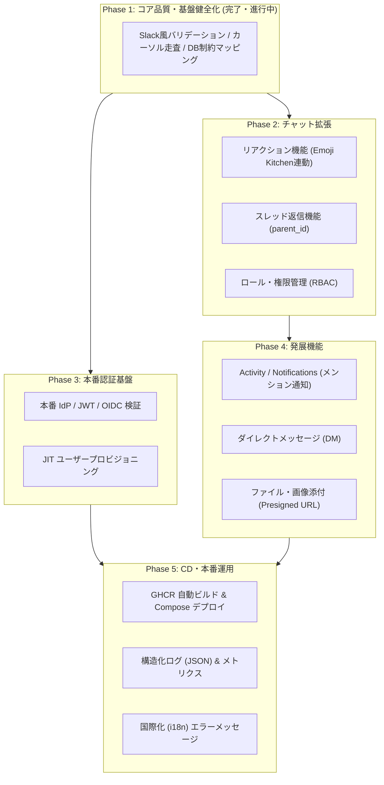

# バックエンド Phase 2 以降の開発ロードマップ

本ドキュメントは、バックエンドの初期実装（Phase 1: コア品質・Slack 準拠バリデーション・ElectricSQL Shape プロキシ基盤）完了後に行う、Phase 2 以降の機能拡張および本番運用の設計・実装計画をまとめたものです。

> [!NOTE]
> **読み取りと書き込みの責務分離方針:**
> 本システムでは `docs/electric-sync-requirements.md` に従い、データの読み取り・リアルタイム同期・過去ログのページングはすべて **ElectricSQL Shape プロキシ (`GET /api/shapes/*`)** とその `subset__*` パラメータ（`subset__limit`, `subset__offset`, `subset__where` 等）に一本化します。REST API は書き込み（楽観更新のための `txid` ハンドシェイク）に特化し、REST 側での重複したカーソルページネーション二重管理は行いません。

---

## 目次
1. [全体タイムライン](#1-全体タイムライン)
2. [Phase 2: チャット機能の第2弾（リアクション・スレッド・RBAC）](#2-phase-2-チャット機能の第2弾リアクションスレッドrbac)
3. [Phase 3: 本番認証 (Production Auth) & ユーザー管理](#3-phase-3-本番認証-production-auth--ユーザー管理)
4. [Phase 4: 発展機能（通知・DM・メディア）](#4-phase-4-発展機能通知dmメディア)
5. [Phase 5: 本番インフラ・CD & 運用性向上](#5-phase-5-本番インフラcd--運用性向上)
6. [フロントエンド開発フェーズとの連携](#6-フロントエンド開発フェーズとの連携)

---

## 1. 全体タイムライン



---

## 2. Phase 2: チャット機能の第2弾（リアクション・スレッド・RBAC）

### 2.1 リアクション機能 (Reactions)
- **概要**: メッセージに対する絵文字リアクションの追加・削除。Issue #5「Emoji Kitchenに対応してほしい」の基盤となる。
- **仕様方針**:
  - `docs/electric-sync-requirements.md` §6 の決定に基づき、集計カラムは持たずレコード単位で管理するため、他の書き込みと同じ `txid` ハンドシェイクがそのまま適用可能。
- **データベース設計**:
  ```sql
  CREATE TABLE message_reactions (
    id text NOT NULL PRIMARY KEY,
    message_id text NOT NULL REFERENCES messages(id) ON DELETE CASCADE,
    user_id text NOT NULL REFERENCES users(id) ON DELETE CASCADE,
    emoji text NOT NULL,
    created_at timestamp(3) NOT NULL DEFAULT CURRENT_TIMESTAMP,
    CONSTRAINT message_reactions_unique UNIQUE (message_id, user_id, emoji)
  );
  ALTER TABLE message_reactions REPLICA IDENTITY FULL;
  ```
- **REST API (書き込み)**:
  - `POST /api/messages/{id}/reactions`: リアクション追加 + `txid` 返却
  - `DELETE /api/messages/{id}/reactions?emoji={emoji}`: リアクション削除 + `txid` 返却
- **ElectricSQL Shape プロキシ (読み取り)**:
  - `GET /api/shapes/message_reactions?channel_id=...`:
    指定チャンネルのメッセージに紐づくリアクションを購読（サブクエリ `message_id IN (SELECT id FROM messages WHERE channel_id = $1 AND deleted_at IS NULL)` を利用）。

### 2.2 スレッド返信機能 (Thread / Replies)
- **概要**: 特定のメッセージに対する返信（スレッド）の投稿・閲覧。
- **設計課題と解決策**:
  - 親メッセージに `reply_count` や `last_reply_at` などの集計カラムを持たせると、子メッセージ INSERT と親 UPDATE が同一 `txid` になり、クライアント側のクエリ購読でイベントの重複や取りこぼしが発生する（`docs/electric-sync-requirements.md` §2, §6 参照）。
  - **解決策**:
    1. バックエンドでは `messages` テーブルに `parent_id (nullable)` のみを追加し、行集計カラムは持たない。
    2. 返信数や最終返信時刻は、フロントエンドの TanStack DB live query（クライアント側集約）で解決する。
- **データベース変更**:
  ```sql
  ALTER TABLE messages ADD COLUMN parent_id text REFERENCES messages(id) ON DELETE RESTRICT;
  CREATE INDEX idx_messages_parent_id ON messages (parent_id);
  ```
- **API**:
  - メッセージ送信 `POST /api/messages` に `parent_id: Option<String>` を追加。
  - スレッド購読用 Shape: `GET /api/shapes/messages?parent_id=...` または既存 messages Shape への統合。

### 2.3 ロール・権限管理 (RBAC) の適用
- **概要**: 既存スキーマにある `role`, `user_role` テーブルを活性化し、権限に応じた認可制御を実施。
- **実装内容**:
  - ワークスペース管理者 / チャンネル管理者の定義。
  - チャンネルのアーカイブ・削除、メンバーキック、不適切メッセージの強制削除権限。

---

## 3. Phase 3: 本番認証 (Production Auth) & ユーザー管理

### 3.1 本番 IdP / JWT / OIDC 検証基盤
- **現状**: `DEV_AUTH_ENABLED=true` ガードによる開発用認証（`X-Dev-User` / `Bearer <UUID>`）のみ実装されており、本番環境 (`ENVIRONMENT=production`) ではすべて `403 Forbidden` となる fail-closed 設計。
- **実装内容**:
  - OIDC / JWT プロバイダ（Clerk, Supabase Auth, Auth0, Firebase 等）の検証ロジックを [auth.rs](../backend/src/auth.rs) に実装。
  - JWKS (JSON Web Key Set) エンドポイントから公開鍵を取得し、メモリキャッシュ。
  - JWT の署名、有効期限（`exp`）、発行者（`iss`）、オーディエンス（`aud`）の検証。
  - 抽出した `sub` クレームを内部ユーザー ID として解決。

### 3.2 JIT (Just-In-Time) ユーザープロビジョニング
- **実装内容**:
  - 初回ログイン時に JWT のクレーム（メールアドレス、表示名、アバター URL など）を参照し、DB の `users` テーブルへ自動作成。
  - プロフィール更新 API (`PATCH /api/users/me`) の提供。

---

## 4. Phase 4: 発展機能（通知・DM・メディア）

### 4.1 Activity / Notifications (メンション通知)
- **背景**: フロントエンド Issue #19 のトラッキングにて「Shape は JOIN・集計不可のため、サーバ集約（通知テーブル）で別途検討」として保留された項目。
- **実装内容**:
  - メッセージ投稿時に本文中のメンション（`@ユーザー名`、`@channel`、`@here`）を解析。
  - `notifications` テーブルに通知レコードを作成:
    ```sql
    CREATE TABLE notifications (
      id text PRIMARY KEY,
      user_id text NOT NULL REFERENCES users(id) ON DELETE CASCADE,
      actor_id text NOT NULL REFERENCES users(id) ON DELETE CASCADE,
      channel_id text NOT NULL REFERENCES channels(id) ON DELETE CASCADE,
      message_id text NOT NULL REFERENCES messages(id) ON DELETE CASCADE,
      notification_type text NOT NULL, -- 'mention', 'reply', 'reaction'
      is_read boolean NOT NULL DEFAULT false,
      created_at timestamp(3) NOT NULL DEFAULT CURRENT_TIMESTAMP
    );
    ALTER TABLE notifications REPLICA IDENTITY FULL;
    ```
  - Shape プロキシ: `GET /api/shapes/notifications`（`where user_id = $1` で購読し、未読バッジやアクティビティ欄をリアルタイム更新）。

### 4.2 ダイレクトメッセージ (DM)
- **実装内容**:
  - 1対1または複数人グループ DM のモデリング（チャンネルの `is_dm: boolean` フラグ、または専用テーブル）。
  - 参加者以外には一切 Shape が配信されない厳格なアクセス制御。

### 4.3 ファイル・画像添付
- **実装内容**:
  - オブジェクトストレージ（AWS S3 / Cloudflare R2 / MinIO）への Presigned URL 発行エンドポイント (`POST /api/attachments/presign`)。
  - メッセージ本文への添付メタデータ（画像 URL、サムネイル、ファイル名、サイズ）の付与。

---

## 5. Phase 5: 本番インフラ・CD & 運用性向上

### 5.1 GHCR 自動ビルド & Compose デプロイ
- **背景**: PR #3 のレビュー指摘事項。
- **実装内容**:
  - GitHub Actions で [Dockerfile-backend-deploy](../infra/Dockerfile-backend-deploy) をビルドし、GitHub Container Registry (`ghcr.io/zli-uoa/zoo-backend:${TAG}`) に push。
  - 本番用 Docker Compose / 環境設定（`/etc/zoo/backend.env`）のテンプレート作成とデプロイ自動化。

### 5.2 構造化ログ & メトリクス
- **実装内容**:
  - 本番環境における JSON 形式の構造化ログ出力（`tracing-subscriber::fmt().json()`）。
  - Prometheus 互換メトリクスエンドポイント (`GET /metrics`) の提供。

### 5.3 国際化 (i18n) エラーメッセージ
- **背景**: Issue #6「i18n対応しなければならない」。
- **実装内容**:
  - `Accept-Language` ヘッダを参照し、バリデーションエラーやシステムメッセージを日・英等で切り替えるミドルウェア。

---

## 6. フロントエンド開発フェーズとの連携

| バックエンド側 Phase | フロントエンド側 Phase（Issue #19） | 連携のポイント |
|---|---|---|
| **Phase 1 (現在)**: コア品質・Slack風バリデーション・カーソル走査 | Phase 1: 型・データアクセス層<br>Phase 2: 読み取り<br>Phase 3: 書き込みと楽観更新 | バックエンドの安定したバリデーションと txid 返却により、フロントエンドの書き込みハンドシェイクが確実に動作する。 |
| **Phase 2**: リアクション & スレッド | Phase 4: UI 実装 | UI 構築段階でリアクションやスレッドのコンポーネントを接続可能にする。 |
| **Phase 3**: 本番認証基盤 | Phase 5: バックエンド経由切替 | ローカル direct 接続から本番バックエンド Shape プロキシへの完全切替を完了する。 |
| **Phase 4 & 5**: 通知・DM・CD | Phase 6: テスト・品質 & 本番結合 | 本番環境への自動デプロイと総合 E2E テストを実施する。 |
