## Androidの画面差分

各組は左が変更前、右が変更後。新規の検証画像は変更後のみ。投稿と通知には検証用データを使用。

チャンネルのメンション表示（左がライト、右がダーク）。上から個人宛て、here 宛て、メールアドレスを含む通常の投稿。

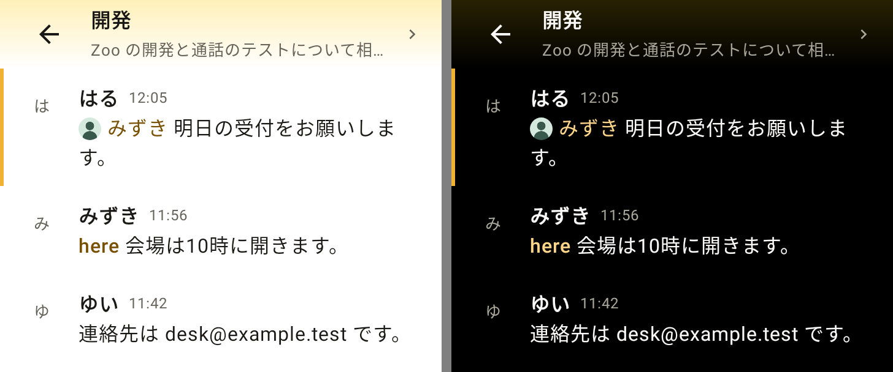

article-preview-dark, article-preview-light, attachment-save-share, bubble-dark, bubble-light, channel-add-member-dark

channel-add-member-light, channel-edit-dark, channel-edit-light, channel-link-dark, channel-link-light, channel-media-dark

channel-media-light, channel-save-error-dark, channel-save-error-light, channel-settings-dark, channel-settings-light, channels-dark

channels-light, chat-attachment-retry-dark, chat-attachment-retry-light, composer-limit-dark, composer-limit-light, conversation-dark

conversation-idle-dark, conversation-idle-light, conversation-light, edit-original-dark, edit-original-light, embedded-post-dark

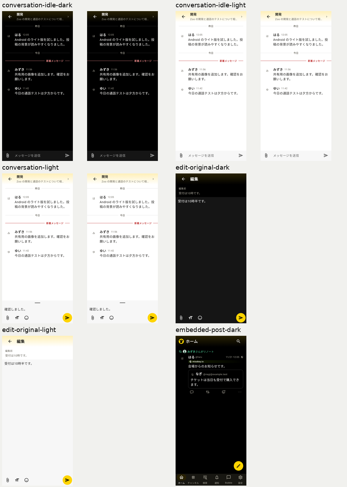

embedded-post-light, emoji-picker-custom-dark, emoji-picker-custom-light, emoji-picker-dark, emoji-picker-kitchen-dark, emoji-picker-kitchen-light

emoji-picker-light, emoji-picker-search-exact-first, emoji-picker-wide-light, follow-response-dark, follow-response-light, home-dark

home-light, home-media-dark, home-media-light, home-rich-dark, home-rich-light, image-description-dark

image-description-light, login-dark, login-light, login-restoring-dark, login-restoring-light, message-menu-dark

message-menu-light, navigation-cache-dark, navigation-cache-light, notifications-dark, notifications-history-error-dark, notifications-history-error-light

notifications-light, opening-conversation-error-large, post-attachment-retry-dark, post-attachment-retry-light, post-compose-federation-off-dark, post-compose-federation-off-light

post-dark, post-light, post-loading-replies-dark, post-loading-replies-light, post-menu-dark, post-menu-light

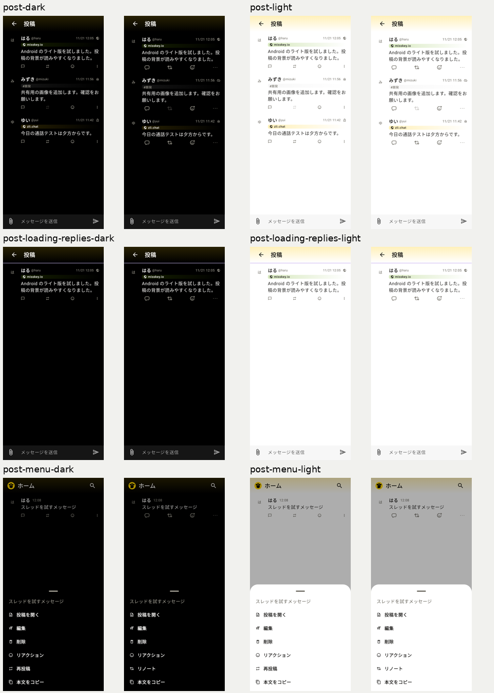

post-offline-large, profile-dark, profile-follow-pending-dark, profile-follow-pending-light, profile-light, quote-renote-dark

quote-renote-light, reaction-channel-dark-after, reaction-channel-dark-before, reaction-channel-light-after, reaction-channel-light-before, reaction-home-dark-after

reaction-home-dark-before, reaction-home-dark-empty, reaction-home-light-after, reaction-home-light-before, reaction-home-light-empty, reaction-offline-dark

reaction-offline-light, repost-pending-dark, repost-pending-light, search-dark, search-error-dark, search-error-light

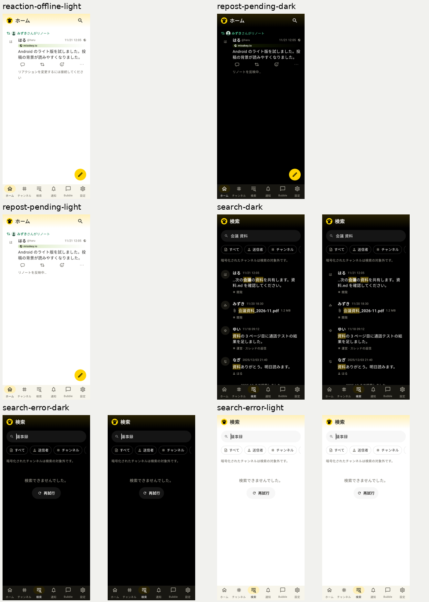

search-files-dark, search-files-light, search-filter-sheet-dark, search-filter-sheet-light, search-filtered-dark, search-filtered-light

search-light, search-older-dark, search-older-light, search-prompt-dark, search-prompt-light, sending-home-dark

sending-home-light, settings-dark, settings-light, share-destination-dark, share-destination-light, shared-post-link-dark

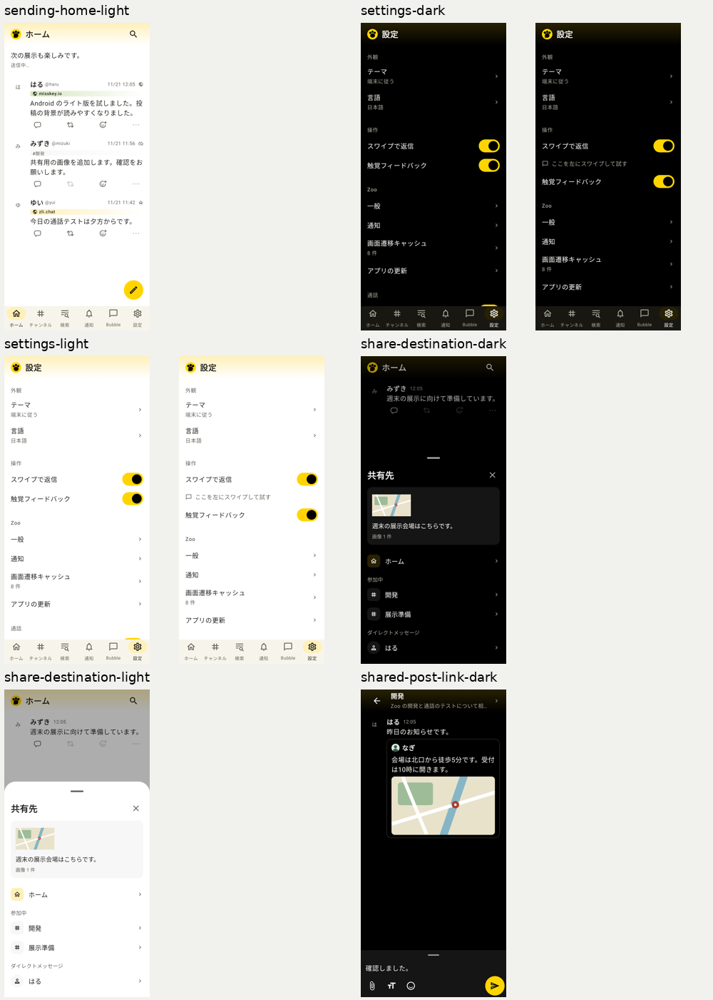

shared-post-link-light, typing-channel-dark, typing-channel-light, os-notifications, os-share

## 操作の比較

チャンネル120件とDM80件の共有先。左から一覧の先頭、末尾、同名の相手をIDで絞り込んだ状態。

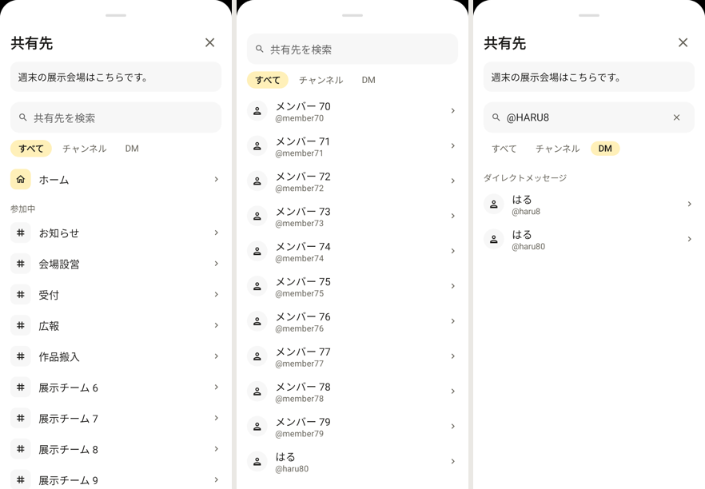

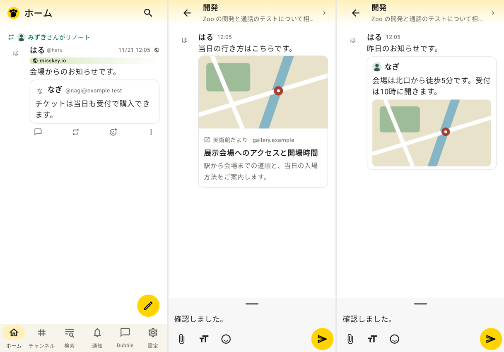

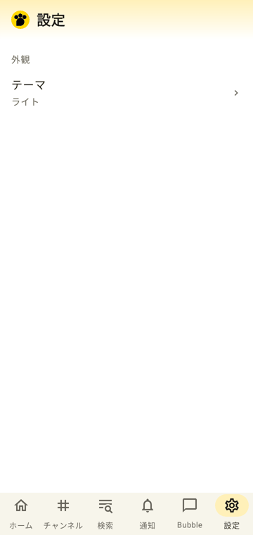

## リノートと引用リノート

アバター画像がない場合の頭文字と表示名の縦位置。左が変更前、右が変更後。

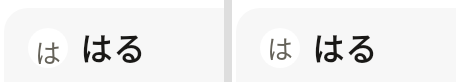

引用リノートの作成画面では、引用カードと投稿操作列を12dp離す。左が変更前、右が変更後。

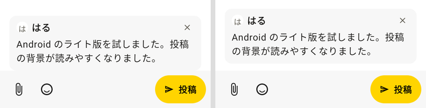

名前は太字、アイコンと文字はライトで #007747、ダークで #52D9A1。リノートした人の写真は元の色で円形に表示する。引用ヘッダーの表示名とアカウントIDはベースラインを揃え、アバターと本文を同じ左端から始める。

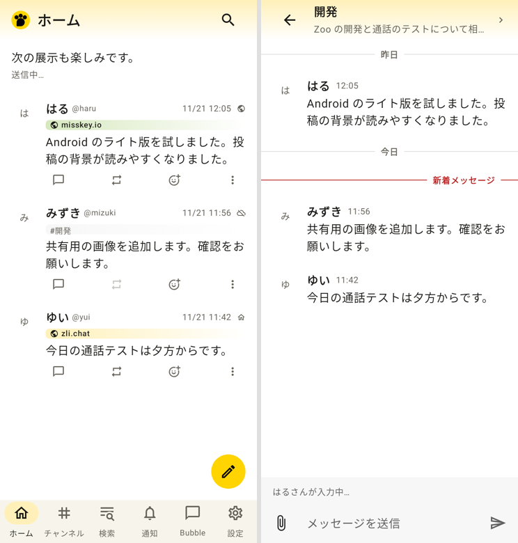

[操作の一覧](operations.md)

## 比較したAndroid APK

- Slack 26.11.40.0 の外部共有プレビューでは、正方形の画像に対して右上に media_cancel を配置する。APK内の external_media_upload_holder.xml で上下左右の制約とリソースIDを照合した。中央の video_icon は動画用。Zooの画像内の再試行ボタンは失敗した画像を直接操作するための配置。
- X 12.46.1-prod.01 のDEXには返信・リポスト・ハートのアウトラインアイコンへの参照があり、文字列テーブルには quote_tweet がある。Zooでは通常のリノートと、コメントを書く引用リノートを同じ入口から選択する。緑の色値はZooの背景に合わせたもの。
- Discord 355.10 Stable のリソースではリアクション背景に既定・参加済みと各テーマの組があり、ic_reaction_icon_16dp と add_reaction がある。Zooの操作アイコンやロゴには他社の画像を使っていない。

## キャッシュと再表示

[Tusky 29.0の配布APK](https://github.com/tuskyapp/Tusky/releases/tag/v29.0) のDEXにある HomeTimelineEntity の主キーは投稿IDとアカウントIDの組で、タイムラインデータをアカウント単位で削除するSQLもある。Slackの文字列には Reset cache と対象の画像・ファイル・データの説明、Xのリソースには settings_manage_storage_clear_network_cache_title がある。

Zooではホームの先頭から安全に再表示できる公開投稿を最大12件、5分間保持する。起動時に表示できる場合もサーバーに最新状態を問い合わせる。スクロールで画面外に出た公開投稿リンクのプレビューは最大30秒、通常は8件まで保持する。どちらもZoo側で選んだ値。設定の「画面キャッシュを消去」はホームと開いた画面の保存内容を対象にし、編集中の下書きと保持件数の設定を保つ。

## OSのステータスバー

API 35のエミュレーターで、同じホームのCompose画面をライトとダークで撮影した。上端までアプリの背景色を敷き、時計・電池アイコンは背景に合わせて明暗を切り替える。

## 投稿操作の図柄と大きさ

左が変更前、右が変更後。同じ投稿を同じ倍率で描画した。返信・リノート・リアクション追加・その他の図柄は20dp、透明な操作列は高さ36dp。添付の再試行と削除は操作範囲が重ならないように離した。

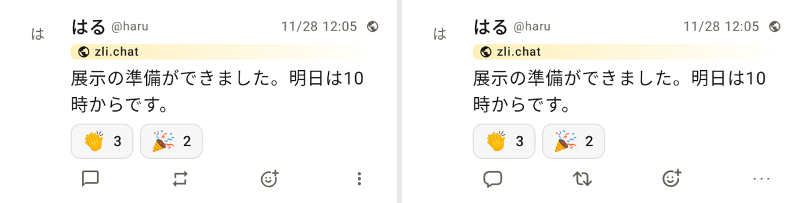

[155状態のCompose操作領域（dp）](control-bounds.tsv)。無効な操作、同じ操作の繰り返し、シート背後の画面も含む。座標は各Composeルート内の値。

## 共通の検索欄と一覧行

左から全文検索、共有先の検索結果、チャンネル検索。どの検索欄でも右端の×で入力を消去できる。

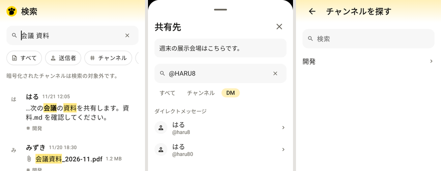

## 操作シートと人物表示

投稿メニュー、検索条件、絵文字ピッカーに共通のシートを使用。つまみと面の色は共通で、絵文字ピッカーはドラッグで全画面に展開できる。

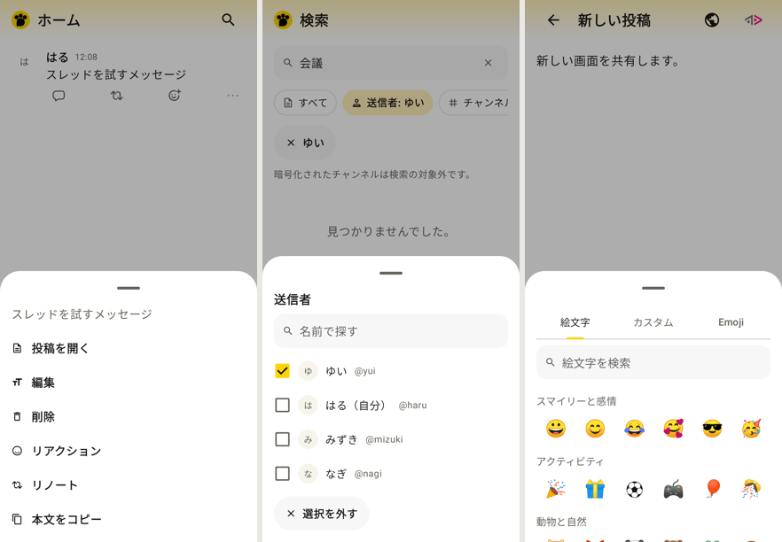

通知・プロフィール・着信に表示するアバター。写真の切り抜きと、写真がない場合の頭文字の位置を共通化した。

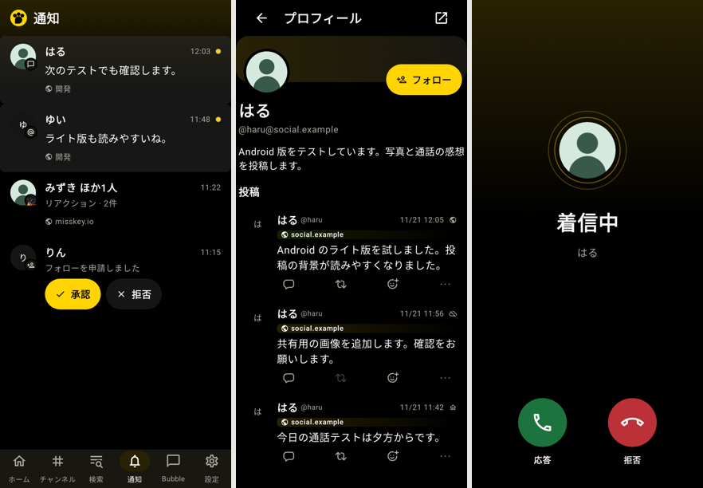

## 選択メニューとダイアログ操作

公開範囲と検索対象の選択中の項目は、どちらも右端にチェックを置く。

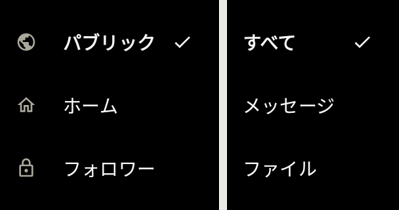

[添付の保存と共有](../rebuild/attachment-save-share.png)
