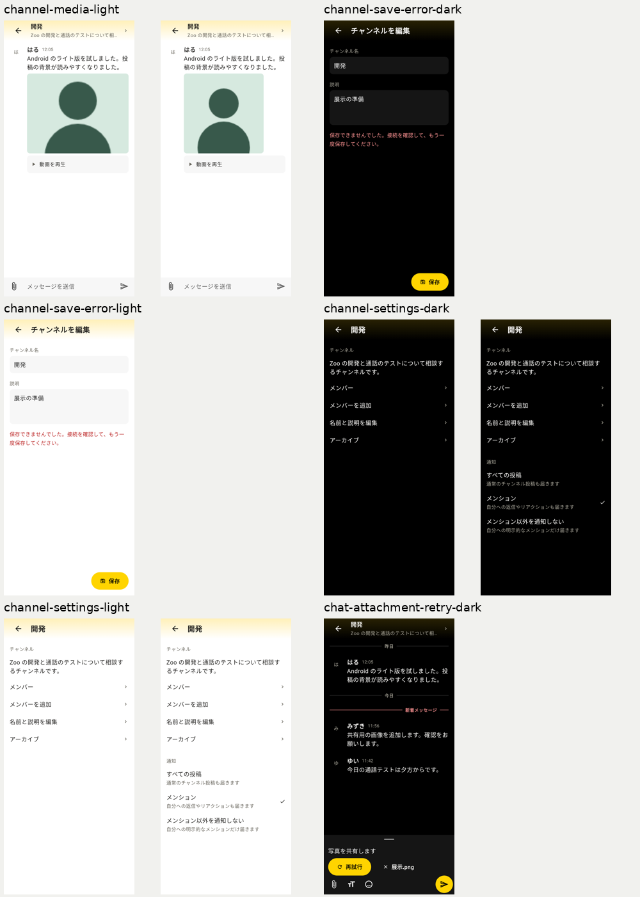
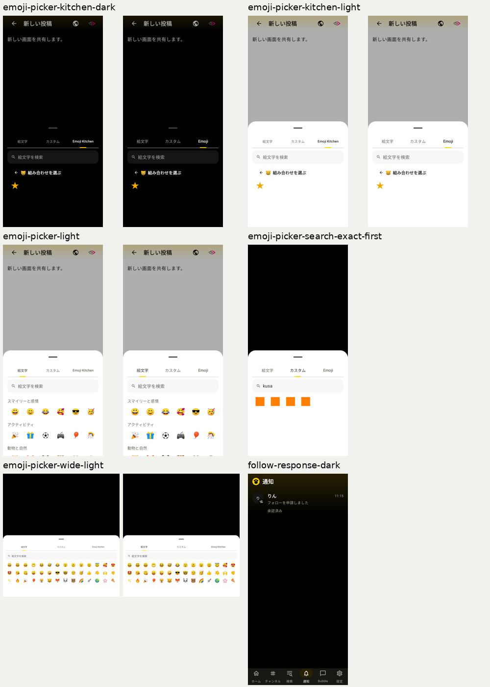
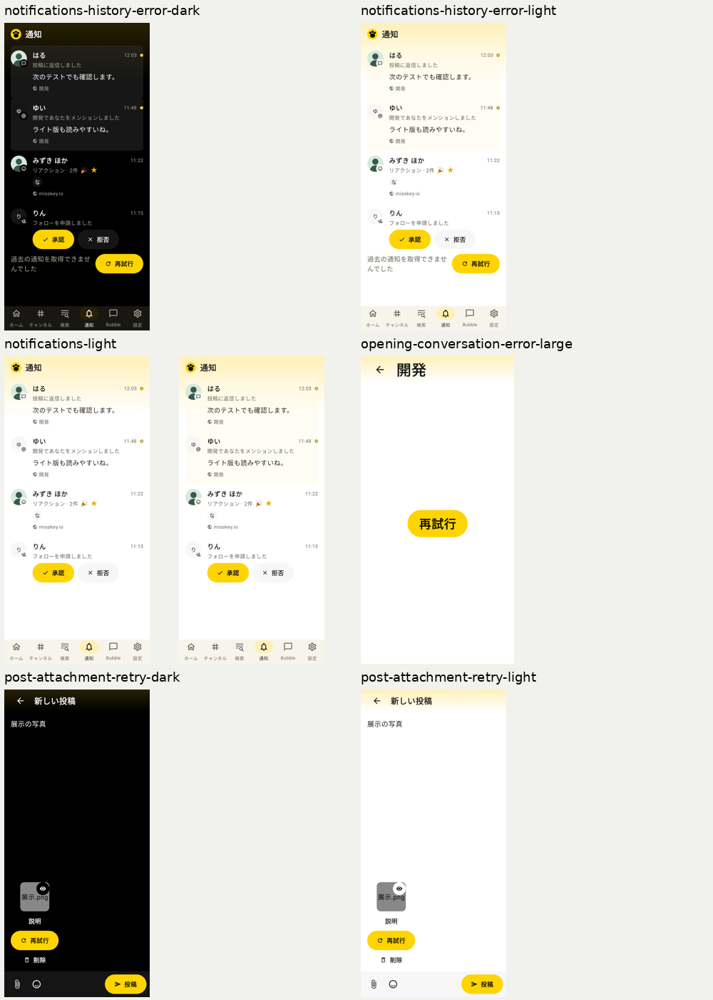
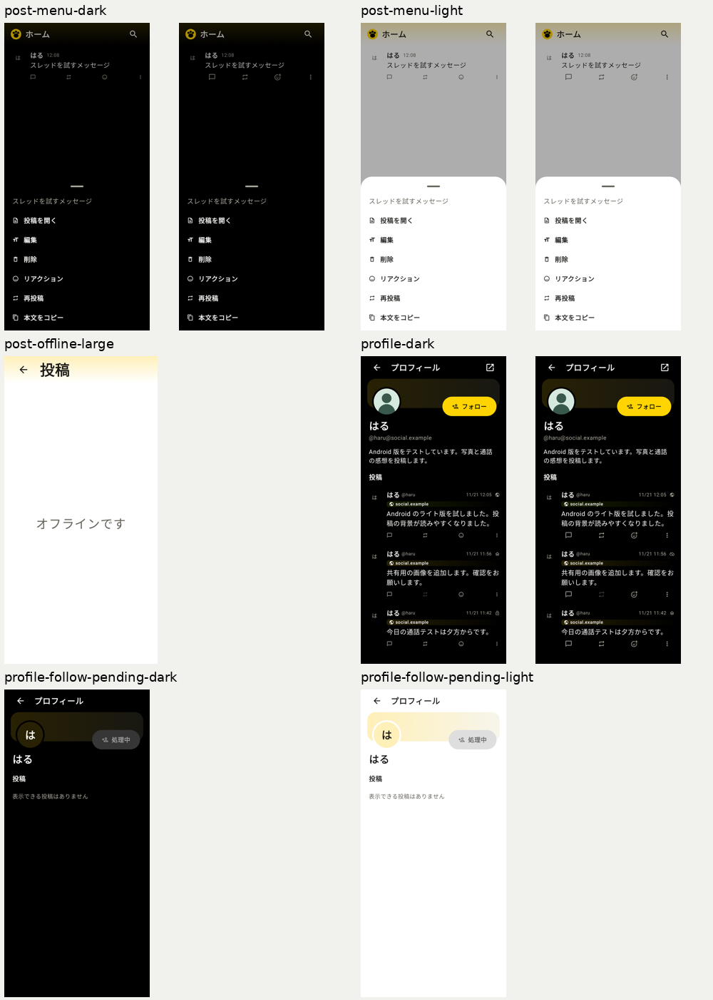
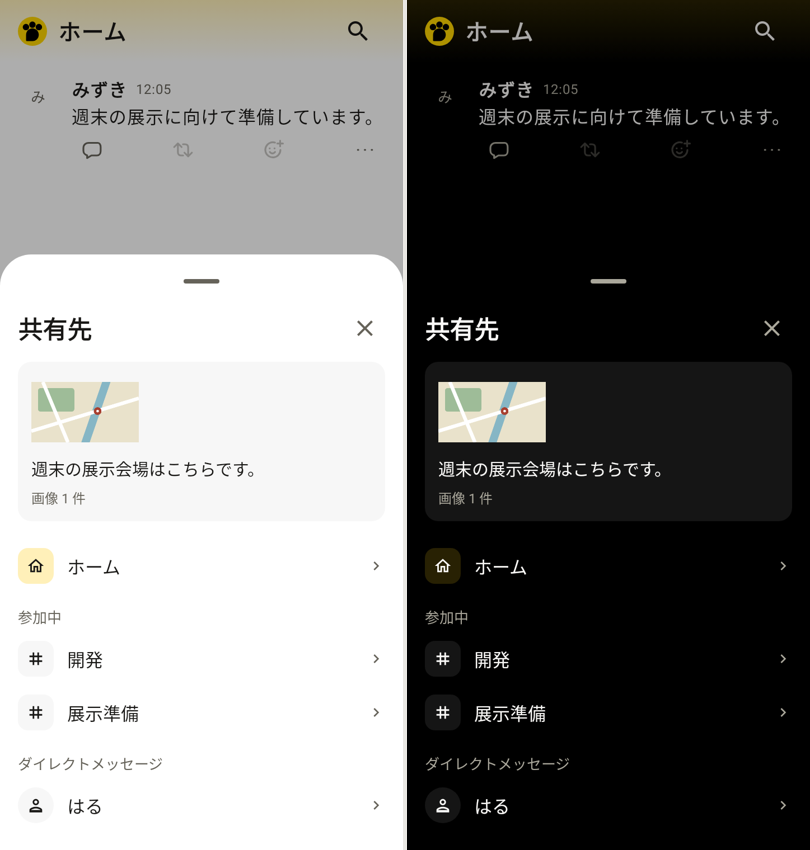
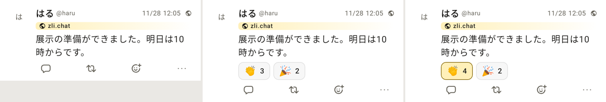
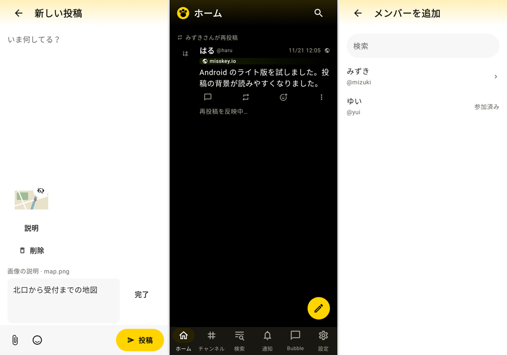

## Androidの画面差分

各組は左が変更前、右が変更後。新規の検証画像は変更後のみ。投稿と通知には検証用データを使用。

article-preview-dark, article-preview-light, attachment-save-share, bubble-dark, bubble-light, channel-add-member-dark

channel-add-member-light, channel-edit-dark, channel-edit-light, channel-link-dark, channel-link-light, channel-media-dark

channel-media-light, channel-save-error-dark, channel-save-error-light, channel-settings-dark, channel-settings-light, chat-attachment-retry-dark

chat-attachment-retry-light, composer-limit-dark, composer-limit-light, conversation-dark, conversation-light, edit-original-dark

edit-original-light, embedded-post-dark, embedded-post-light, emoji-picker-custom-dark, emoji-picker-custom-light, emoji-picker-dark

emoji-picker-kitchen-dark, emoji-picker-kitchen-light, emoji-picker-light, emoji-picker-search-exact-first, emoji-picker-wide-light, follow-response-dark

follow-response-light, home-dark, home-light, home-media-dark, home-media-light, home-rich-dark

home-rich-light, image-description-dark, image-description-light, message-menu-dark, message-menu-light, notifications-dark

notifications-history-error-dark, notifications-history-error-light, notifications-light, opening-conversation-error-large, post-attachment-retry-dark, post-attachment-retry-light

post-compose-federation-off-dark, post-compose-federation-off-light, post-dark, post-light, post-loading-replies-dark, post-loading-replies-light

post-menu-dark, post-menu-light, post-offline-large, profile-dark, profile-follow-pending-dark, profile-follow-pending-light

profile-light, reaction-channel-dark-after, reaction-channel-dark-before, reaction-channel-light-after, reaction-channel-light-before, reaction-home-dark-after

reaction-home-dark-before, reaction-home-dark-empty, reaction-home-light-after, reaction-home-light-before, reaction-home-light-empty, reaction-offline-dark

reaction-offline-light, repost-pending-dark, repost-pending-light, search-dark, search-files-dark, search-files-light

search-filter-sheet-dark, search-filter-sheet-light, search-filtered-dark, search-filtered-light, search-light, settings-dark

settings-light, share-destination-dark, share-destination-light, shared-post-link-dark, shared-post-link-light, os-notifications

os-share

## 操作の比較

[調査と操作の全122項目](operations.md)

