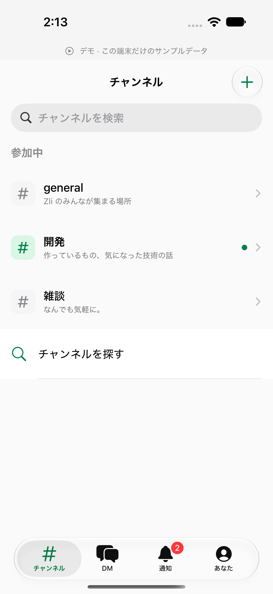
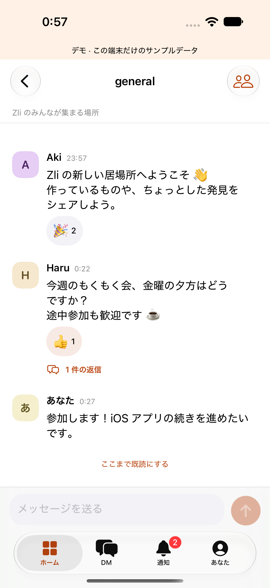
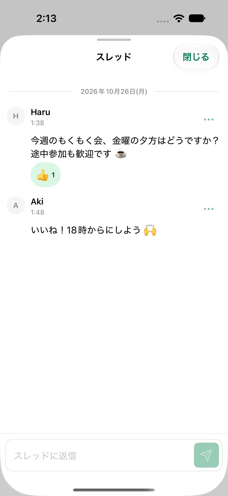
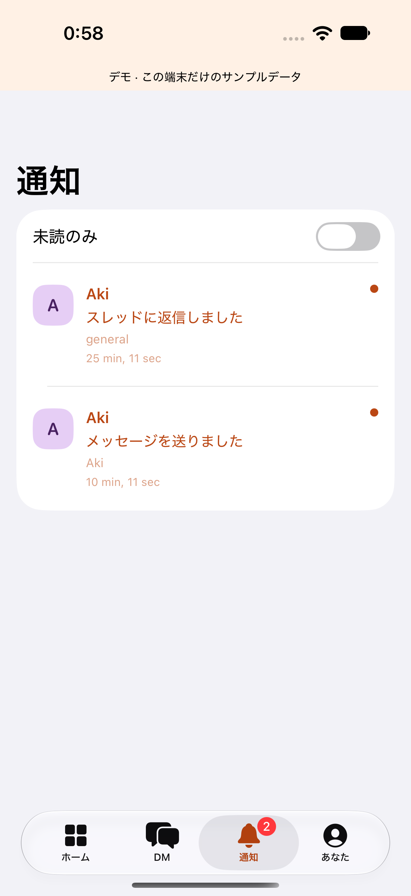

# Zoo for iOS

A SwiftUI client for Zli's zoo2 workspace. Requires iOS 18 or later. The existing
Rust backend remains the authority for identity, membership, and authorization.
No backend or database changes are included.

## Architecture

The client uses feature-oriented MVVM and injectable repositories. See
[Architecture](docs/architecture.md) for ownership, dependency boundaries,
synchronization lifetimes and testing conventions.

## Run locally

Open `Zoo.xcodeproj`, select the `Zoo` scheme and an iOS Simulator, then run.
Choose **Try demo** (`デモを試す`) to explore the app without an account or network.
The demo banner remains visible; demo messages are in memory only and are cleared
on logout. The launch argument `--demo` opens this mode directly.

The checked-in Xcode project needs no package downloads. When adding files, install
XcodeGen and regenerate the project from `project.yml` using `make generate`.

```sh
cd ios
make build
make test
# Use any installed simulator when the default name is unavailable:
make test DESTINATION='platform=iOS Simulator,name=iPhone 17'
```

`make test` runs protocol, authentication, network, store, and UI tests. Network
tests intercept every request with URLProtocol. UI tests use the isolated demo;
they never write to the production workspace. Build products stay in `.build/`.
These Simulator commands use ad-hoc signing so Keychain access can be tested;
they do not use a distribution certificate. Set a development team in Xcode
for a physical device; never add signing credentials to this repository.

## Connect to Zli

The public defaults match zoo2's current deployment:

| Setting | Value |
| --- | --- |
| API server | `https://zli.chat` |
| OIDC issuer | `https://account.zli.works/api/auth` |
| Resource / API audience | `https://zli.chat/api` |
| Scope | `openid profile offline_access` |
| Redirect URI | `zoo2://oauth/callback` |

The native OAuth client has **not been registered** as of implementation. The
web client ID is deliberately not reused. An identity administrator must register
a public native client with the exact redirect URI above, authorization code flow,
PKCE S256, and access to the existing API resource. Enable refresh tokens if
supported. Public clients must not require an embedded client secret. Confirm
that the resulting access token has the issuer and audience expected by zoo2.

Enter that client ID in **Connection settings** (`接続設定`) on the welcome screen,
save, and log in. ASWebAuthenticationSession handles browser authentication;
the client verifies callback scheme, host, path and OAuth state before exchanging
the code. Access/refresh tokens are stored in the device-only Keychain, scoped by
connection settings. Concurrent token refreshes share one exchange. Logout clears
tokens, subscriptions, in-memory messages and drafts. It does not revoke other
devices' sessions. Native HTTPS requests do not need browser CORS changes.

Production login and real-account integration remain unverified until this client
is registered. Do not interpret demo tests as production authentication coverage.

## Implemented flows

- Search, browse and create public/private channels; join public channels.
- Rename, describe, archive and restore channels according to existing permissions.
- View/add members, leave a channel, and start or resume a one-to-one DM.
- Receive message/reaction changes via the authorized Electric Shape proxy.
- Post messages, reply in threads, edit/delete own messages, and toggle reactions.
- Retain drafts during navigation and failed sends; use a stable submission ID
  when retrying a request whose result is unknown.
- Read notification activity and navigate to its conversation/thread.
- Display server unread state and explicitly mark a visible conversation read.
- Edit the current user's display name and log out.
- Support Dynamic Type, system appearance, iPhone/iPad layouts and VoiceOver labels.

Read models use `/api/shapes/*`, including cursor/handle continuation, partial
updates, string booleans, 409/must-refetch resets, cancellation and bounded retry
backoff. Live updates use Electric long polling. Only the selected conversation's
messages and reactions are subscribed; channel/user/membership/notification
streams are workspace-wide. Streams stop in the background and reconnect on
return. Full channel history is synchronized in memory; the UI reveals it in
100-message batches. Subset-based network pagination and disk caching are not
implemented, so very large channels need further scalability work.

Writes use existing REST envelopes `{ data, txid }`. A successful response means
the server committed the write. Confirmed outgoing posts remain visible until
their Shape record arrives; edits and deletions are rendered from authoritative
Shape updates. The app does not fabricate a successful offline write.

## Release blockers and parity gaps

- Register the iOS OAuth client and verify real login, token refresh, logout,
  authorization loss, and two-device messaging against a staging workspace.
- Native background push delivery is not implemented. The backend currently
  implements Web Push, which is not an APNs device-token registration API.
  Native push requires APNs entitlement/signing, device registration and backend
  delivery work, plus device verification. No push permission is requested yet.
- Member removal, typing presence, Emoji Kitchen rendering, and full web-client localization are
  not included. Messages currently display their literal text.
- File attachments and MFM are not claimed: their referenced zoo2 PRs were not
  part of the inspected main revision `74d540d`.
- App Store/TestFlight distribution, provisioning and privacy review are not
  completed by a Simulator build.

This is a local native client implementation, not a production-ready declaration
or complete feature parity with the web application. These blockers must be
resolved before calling the overall iOS product complete.

## Local development loop

Use one task branch/worktree, implement a bounded feature, run `make build` and
`make test`, then request an independent diff review. Fix findings and rerun
affected checks before integration. Keep acceptance criteria and test evidence
with the change. No daemon, scheduler, automatic push or automatic merge is
installed. The app icon is reproducible with `make icon`.

## Validation evidence

The architecture migration preserves protocol and UI coverage and adds tests for
shared feature state, channel isolation, subscription readers, draft preservation,
late responses after logout, transient recovery, and received-history release.
Validated on 2026-10-26 with Xcode 27.1 and the iPhone 18 Pro iOS 27 Simulator:
35 unit/network/feature tests and 4 UI tests passed in separate invocations.
The earlier combined run encountered a test-host bootstrap failure and a failed
UI tap; both suites passed when rerun separately. The final independent
`reviewer-jp` review reported no significant findings.

Production OAuth and real-account integration remain subject to the release
blockers above.

## Review screenshots

These screenshots use synthetic demo data on an iPhone 18 Pro Simulator running
iOS 27. They show local UI behavior, not a verified production connection.
The `testReviewScreenshots` UI test captures the original PNGs as persistent
XCTest attachments. Include these images in the pull request description.

| Home | Conversation |
| --- | --- |
|  |  |

| Thread | Notifications |
| --- | --- |
|  |  |
