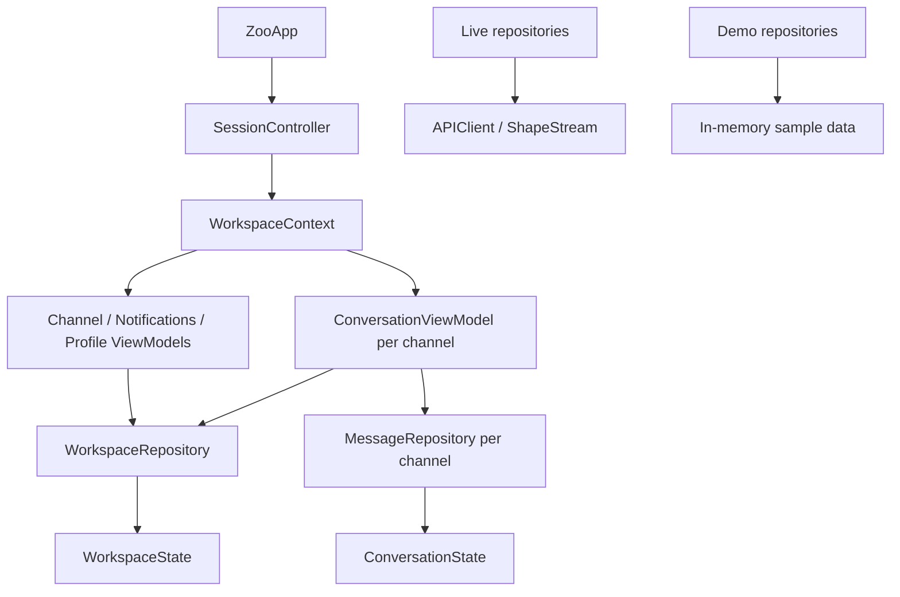

# iOS architecture

Zoo uses feature-oriented MVVM with repository boundaries and Swift Observation.
SwiftUI views render observable state and forward user actions. View models own
presentation rules; repositories own network or in-memory data access. There is
no dependency injection framework or global mutable application store.

## Ownership and dependencies

- `App/SessionController.swift` owns authentication, connection settings, account
  transitions, application lifecycle and the user-facing error boundary.
- `App/WorkspaceContext.swift` creates feature models and shares one conversation
  model for each channel across navigation entry points. It does not implement
  API requests or message mutation rules.
- `Features/` contains views and their view models, grouped by user-facing feature.
  Views do not know API paths, Shape handles or how demo writes are implemented.
- `Domain/` contains data types, observable state, synchronization phases and pure
  validation/permission rules. Backend authorization remains authoritative.
- `Data/Repositories/` contains repository contracts and live implementations.
  `Networking/`, `Realtime/` and `Authentication/` implement transport protocols.
- `PreviewSupport/` provides the same repository contracts with synthetic data.
  Demo writes do not enter the live HTTP transport.

## Sources of truth

`WorkspaceState` is shared by the channel, notification and profile models.
Updating the current user is therefore immediately visible in every feature that
reads that user. Feature models expose the state they need without copying it.

Each `MessageRepository` owns one `ConversationState`. The state merges confirmed
Shape rows with REST-acknowledged posts awaiting replication, deduplicates by ID,
and builds the timeline and reply counts once per update. Views never mutate
message arrays directly.

A `ConversationViewModel` owns drafts, in-progress submission state and stable
retry IDs. These survive navigation and incomplete resynchronization. Its
repository owns received messages, reactions and the channel subscriptions.

## Lifetimes and synchronization

- A conversation has a set of reader IDs. Opening it from two entry points shares
  one subscription; closing one reader does not stop the other. The last reader
  stops the subscription.
- Live repositories release received history and reactions when stopped. Drafts,
  retry IDs and committed posts awaiting replication remain until confirmation,
  access loss or logout. The app does not retain all visited channel histories.
- Backgrounding stops workspace streams, unread polling and conversation streams.
  Foregrounding restarts workspace streams and only conversations with readers.
- `SyncPhase` distinguishes initial loading, resynchronization, ready data,
  transient failure and denied access. An incomplete empty channel snapshot does
  not imply access loss. A complete snapshot or explicit authorization rejection
  may clear the affected conversation and its drafts.
- A successful no-content long-poll response recovers a transient failure only
  after the stream has supplied a complete snapshot. Denied access is shown in
  the affected conversation; closed conversations do not keep the global retry
  banner visible.
- Subscription generations reject callbacks from stopped subscriptions.
  `RepositorySession` rejects REST results after account invalidation. Logout
  invalidates the session before stopping repositories and clearing all state.
- REST submission IDs stay stable after an uncertain response. Successful
  replication can also confirm a send. Input typed during a pending send is not
  cleared when the earlier send completes.

## Testing boundaries

- Protocol tests cover PKCE, callback validation, Shape decoding and timestamps.
- Network tests inject URLProtocol into the live transport and exercise backend
  envelopes, token refresh, paging, recovery and session invalidation.
- Feature tests use demo repositories to verify shared state and account teardown.
- Conversation view-model tests inject a controlled repository to drive failures,
  suspended requests, multiple readers and lifecycle changes deterministically.
- UI tests use demo mode for navigation, posting, threads and review screenshots.

Add a feature beside its view model. Add a repository method when the feature
needs a new data operation, and implement it for both live and demo backends.
Only introduce another abstraction when it isolates a concrete responsibility or
allows a meaningful test; a one-line forwarding use-case type is not required.
